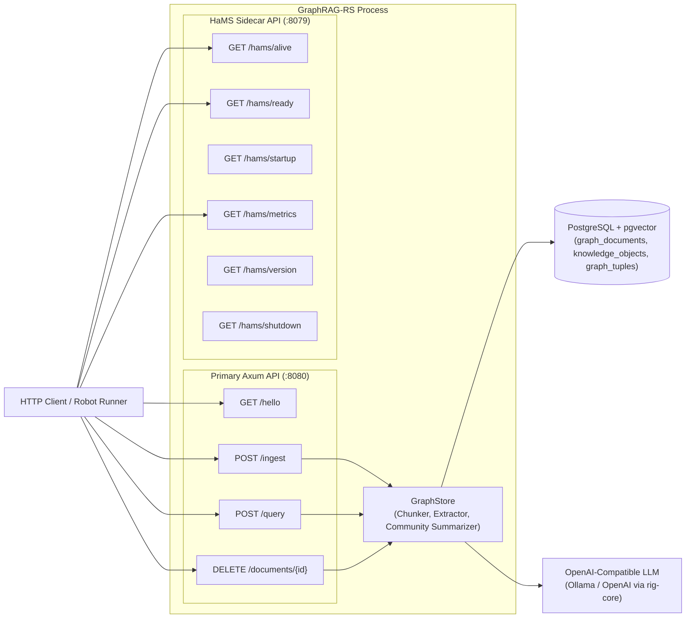

# GraphRAG-RS

[](https://www.rust-lang.org)
[](https://opensource.org/licenses/MIT)
[](https://github.com/PolecatWorks/Graphrag/actions)

**GraphRAG-RS** is a high-performance Rust microservice that ingests Markdown documents, extracts Knowledge Objects (nodes) and Graph Tuples (edges), builds hierarchical community summaries, and answers single-hop and multi-hop natural-language queries using semantic vector search (`pgvector`) and graph traversal.

## Table of Contents

- [Architecture Overview](#architecture-overview)
- [API Reference](#api-reference)
  - [Primary GraphRAG API (`:8080`)](#primary-graphrag-api-8080)
  - [Health Monitoring Sidecar (HaMS) API (`:8079`)](#health-monitoring-sidecar-hams-api-8079)
- [Quickstart & Local Setup](#quickstart--local-setup)
- [Configuration](#configuration)
- [Testing](#testing)
- [Documentation & Guidelines](#documentation--guidelines)
- [Contributing](#contributing)

---

## Architecture Overview

This project is built as a concurrent Rust microservice exposing two independent HTTP listeners:
1. **Primary GraphRAG Service (`:8080`)**: Built on [Axum](https://github.com/tokio-rs/axum) (`src/routes.rs`, `src/graph_rag.rs`) handling document ingestion, graph/vector storage, and RAG question answering.
2. **Health Monitoring Sidecar (`:8079`)**: Powered by the [`hams`](https://github.com/PolecatWorks/hams) crate (`src/hams_tools.rs`) serving liveness, readiness, startup probes, Prometheus metrics, and graceful shutdown coordination.



---

## API Reference

### Primary GraphRAG API (`:8080`)

By default, the primary Axum service listens on `http://127.0.0.1:8080` (`server_host` and `server_port` in [config.yaml](./config.yaml)).

| Method | Path | Success Status | Description |
|---|---|---|---|
| `GET` | `/hello` | `200 OK` | Basic connectivity and routing sanity check. |
| `POST` | `/ingest` | `200 OK` | Chunks and ingests a Markdown document, extracts Knowledge Objects and Graph Tuples, updates Layer 1 community summaries, and persists to PostgreSQL (`pgvector`). |
| `POST` | `/query` | `200 OK` | Executes 64-d `pgvector` similarity + keyword seed lookup, traverses up to 2 hops across the knowledge graph, and synthesizes a grounded answer via the configured LLM. |
| `DELETE` | `/documents/{id}` | `204 No Content` | Deletes an ingested document and its associated Knowledge Objects and Graph Tuples. |

---

#### 1. `GET /hello`

Verifies that the primary Axum HTTP listener is up and routing requests.

- **Response (`200 OK`, `text/plain`)**:
  ```text
  Hello, World!
  ```
- **Example**:
  ```bash
  curl -i http://localhost:8080/hello
  ```

---

#### 2. `POST /ingest`

Ingests a raw Markdown document into the Graph RAG pipeline (`src/routes.rs`, `src/graph_rag.rs`):
1. Splits the Markdown content by section headings (`#`, `##`, `###`) and paragraphs into bounded semantic chunks.
2. Extracts **Knowledge Objects** (nodes with canonical `snake_case` IDs, labels, descriptions, and 64-d `pgvector` embeddings) and **Graph Tuples** (directed `(source, predicate, target)` edges).
3. Idempotently merges extracted nodes and edges with existing graph knowledge and recomputes Layer 1 `CommunitySummary` nodes and `SUMMARIZES` hierarchy edges.
4. Upserts the document, nodes, and edges into PostgreSQL (`graph_documents`, `knowledge_objects`, `graph_tuples`).

- **Request Headers**: `Content-Type: application/json`
- **Request Body (`IngestRequest`)**:
  ```json
  {
    "filename": "04_michael_collins.md",
    "content": "# Michael Collins (astronaut)\n\nMichael Collins flew the Apollo 11 command module Columbia around the Moon in 1969 while Neil Armstrong and Buzz Aldrin made the first crewed landing on the surface."
  }
  ```
  | Field | Type | Required | Description |
  |---|---|---|---|
  | `filename` | `string` | Yes | Non-empty document filename used as the canonical `document_id`. |
  | `content` | `string` | Yes | Non-empty raw Markdown content to chunk and extract. |

- **Success Response (`200 OK`, `application/json`, `IngestResponse`)**:
  ```json
  {
    "document_id": "04_michael_collins.md",
    "chunks_processed": 1,
    "nodes_extracted": 5,
    "edges_extracted": 4
  }
  ```
  | Field | Type | Description |
  |---|---|---|
  | `document_id` | `string` | Canonical identifier of the ingested document (matches normalized `filename`). |
  | `chunks_processed` | `usize` | Number of semantic Markdown chunks processed. |
  | `nodes_extracted` | `usize` | Number of unique Layer 0 Knowledge Objects extracted from the document. |
  | `edges_extracted` | `usize` | Number of unique Graph Tuples extracted from the document. |

- **Error Response (`400 Bad Request`, `application/json`, `ErrorResponse`)**:
  Returned when `filename` or `content` is empty/whitespace.
  ```json
  {
    "error": "markdown content must not be empty"
  }
  ```

- **Example**:
  ```bash
  curl -X POST http://localhost:8080/ingest \
    -H "Content-Type: application/json" \
    -d '{
      "filename": "04_michael_collins.md",
      "content": "# Michael Collins (astronaut)\n\nMichael Collins flew the Apollo 11 command module Columbia in lunar orbit."
    }'
  ```

---

#### 3. `POST /query`

Answers a single-hop or multi-hop natural-language question using the knowledge graph:
1. Computes a 64-d query embedding and identifies top-K seed `KnowledgeObject` nodes via cosine similarity and keyword matching.
2. Traverses up to 2 hops along outgoing and incoming `GraphTuple` edges to assemble the multi-hop subgraph context (`contexts`).
3. Prompts the configured LLM via `rig-core` (with a deterministic Maximal Marginal Relevance fallback when offline) to synthesize a complete, grounded answer from the retrieved subgraph contexts.

- **Request Headers**: `Content-Type: application/json`
- **Request Body (`QueryRequest`)**:
  ```json
  {
    "question": "Who flew the Apollo 11 command module Columbia in lunar orbit while Neil Armstrong and Buzz Aldrin landed on the Moon?"
  }
  ```
  | Field | Type | Required | Description |
  |---|---|---|---|
  | `question` | `string` | Yes | Non-empty natural-language question to evaluate against the knowledge graph. |

- **Success Response (`200 OK`, `application/json`, `QueryResponse`)**:
  ```json
  {
    "answer": "Michael Collins flew the Apollo 11 command module Columbia in lunar orbit while Neil Armstrong and Buzz Aldrin landed on the Moon.",
    "contexts": [
      "michael_collins (DocumentSection): Michael Collins (October 31, 1930 – April 28, 2021) was an American astronaut who flew the Apollo 11 command module Columbia around the Moon in 1969...",
      "command_module_columbia (Spacecraft): [Michael Collins] Michael Collins (October 31, 1930 – April 28, 2021) was an American astronaut who flew the Apollo 11 command module Columbia...",
      "michael_collins -[MENTIONS]-> command_module_columbia"
    ]
  }
  ```
  | Field | Type | Description |
  |---|---|---|
  | `answer` | `string` | Grounded natural-language answer synthesized from the knowledge graph. |
  | `contexts` | `string[]` | Retrieved node descriptions and relationship triples (`source -[PREDICATE]-> target`) used to ground the answer. |

- **Error Response (`400 Bad Request`, `application/json`, `ErrorResponse`)**:
  Returned when `question` is empty/whitespace.
  ```json
  {
    "error": "question must not be empty"
  }
  ```

- **Example**:
  ```bash
  curl -X POST http://localhost:8080/query \
    -H "Content-Type: application/json" \
    -d '{
      "question": "Which Apollo 11 astronauts graduated from the United States Military Academy at West Point, and in what years did they graduate?"
    }'
  ```

---

#### 4. `DELETE /documents/{id}`

Deletes an ingested document and removes its associated Knowledge Objects and Graph Tuples from both the in-memory graph and PostgreSQL (`graph_documents`, `knowledge_objects`, `graph_tuples`). Used by automated test suites during teardown to keep test runs isolated.

- **Path Parameters**:
  | Parameter | Type | Description |
  |---|---|---|
  | `id` | `string` | The `document_id` returned by `POST /ingest` (e.g., `04_michael_collins.md`). |

- **Success Response (`204 No Content`)**: Empty body.
- **Example**:
  ```bash
  curl -i -X DELETE http://localhost:8080/documents/04_michael_collins.md
  ```

---

#### 5. Model Context Protocol (MCP) Endpoints (`POST /mcp` & `POST /api/v1/mcp`)

GraphRAG-RS exposes an in-process Model Context Protocol (MCP) server over standard HTTP JSON-RPC 2.0 transport matching the patterns of `aad-mcp-container`. AI clients (Antigravity, Cursor, Claude Desktop, and autonomous agents) can connect to discover and execute 23 structured tools for smoke-testing, pipeline execution, and fine-grained BREAD management.

##### Supported JSON-RPC Methods:
- `initialize`: Returns protocol version (`2024-11-05`), capabilities (`tools`), server info, and instructions.
- `notifications/initialized`: Handshake notification returning HTTP `204 No Content`.
- `ping`: Health verification returning `{}`.
- `tools/list`: Lists 23 tools with auto-generated Draft-07 JSON schemas (`schemars`).
- `tools/call`: Executes a tool with `name` and `arguments`.

##### Example: MCP Handshake & Tool Invocation
```bash
# 1. Initialize Handshake
curl -X POST http://localhost:8080/api/v1/mcp \
  -H "Content-Type: application/json" \
  -d '{
    "jsonrpc": "2.0",
    "id": 1,
    "method": "initialize",
    "params": {}
  }'

# 2. Call Smoke-Test Hello Tool
curl -X POST http://localhost:8080/api/v1/mcp \
  -H "Content-Type: application/json" \
  -d '{
    "jsonrpc": "2.0",
    "id": 2,
    "method": "tools/call",
    "params": {
      "name": "hello",
      "arguments": { "name": "Antigravity" }
    }
  }'

# 3. Call Hybrid Graph RAG Query Tool
curl -X POST http://localhost:8080/api/v1/mcp \
  -H "Content-Type: application/json" \
  -d '{
    "jsonrpc": "2.0",
    "id": 3,
    "method": "tools/call",
    "params": {
      "name": "graphrag_query",
      "arguments": { "question": "Who flew the Apollo 11 command module Columbia?" }
    }
  }'
```

---

### Health Monitoring Sidecar (HaMS) API (`:8079`)

The embedded HaMS sidecar listens on a dedicated port (`127.0.0.1:8079` by default, configured under `hams.address` in [config.yaml](./config.yaml)) and starts *before* database connections or the main Axum server are initialized.

| Method | Path | Success Status | Description |
|---|---|---|---|
| `GET` | `/hams/alive` | `200 OK` | Liveness probe (`503 Service Unavailable` if unhealthy). |
| `GET` | `/hams/alive_verbose` | `200 OK` | Verbose liveness probe with individual check details. |
| `GET` | `/hams/ready` | `200 OK` | Readiness probe; returns `200 OK` once the `db-connected` manual signal is enabled after PostgreSQL + `pgvector` and `LlmClient` initialization (`503 Service Unavailable` while bootstrapping). |
| `GET` | `/hams/ready_verbose` | `200 OK` | Verbose readiness probe showing the `db-connected` probe state. |
| `GET` | `/hams/startup` | `200 OK` | Startup probe endpoint. |
| `GET` | `/hams/startup_verbose` | `200 OK` | Verbose startup probe endpoint. |
| `GET` | `/hams/version` | `200 OK` | Returns JSON metadata (`name`, `version`, `hams_name`, `hams_version`). |
| `GET` | `/hams/metrics` | `200 OK` | Exposes Prometheus metrics (`text/plain; version=0.0.4`). |
| `GET` | `/hams/shutdown` | `200 OK` | Triggers the `CancellationToken` shutdown callback to gracefully stop the main Axum server and HaMS sidecar. |

- **Examples**:
  ```bash
  # Check liveness and readiness
  curl -i http://localhost:8079/hams/alive
  curl -i http://localhost:8079/hams/ready

  # Inspect service version and Prometheus metrics
  curl -s http://localhost:8079/hams/version
  curl -s http://localhost:8079/hams/metrics
  ```

---

## Quickstart & Local Setup

The developer workflow is standardized around the root [Makefile](./Makefile). Ensure you have Rust, Cargo, a running PostgreSQL instance with `pgvector` enabled (`localhost:5432`), and an OpenAI-compatible LLM endpoint such as Ollama (`localhost:11434`).

### 1. Database Setup & Migrations
Create the `graphrag` database and apply all pending SQL migrations (`migrations/*.up.sql`):
```bash
make migrate
```

### 2. Running the Development Server
Start the backend server on ports `8080` (Axum) and `8079` (HaMS) using `config.yaml`:
```bash
make dev
```
*Note: `make dev` runs `cargo run -- -c config.yaml` after freeing ports `8080` and `8079`.*

### 3. Hot-Reloading
Run the server with hot-reloading via `cargo watch`:
```bash
make watch
# or
make aad-be-watch
```

### 4. Container & Kubernetes Workflows
Build the multi-architecture Docker image locally:
```bash
make build-docker
```

Run the Docker image locally mapping ports 8080 and 8079:
```bash
make docker-run
```

Deploy the Graphrag Helm chart (`charts/graphrag`) using Garden to your local Kubernetes context:
```bash
make garden-up
```

Run the ephemeral Kubernetes integration test suite (Robot Framework + Ragas) inside the local Garden environment:
```bash
make garden-test
```

---

## Configuration

Configuration is managed centrally via `AppConfig` (`src/config.rs`) using `figment` and validated fail-fast at startup:
- **CLI Flag (`clap` Derive)**: Pass `-c <PATH>` or `--config <PATH>` (`src/cli.rs`).
- **YAML Configuration**: See [config.yaml](./config.yaml) for the default local configuration.
- **Environment Variable Overrides**: Any field in `AppConfig` can be overridden using the `GRAPHRAG_BE__` prefix with `__` nesting (for example, `GRAPHRAG_BE__DATABASE__URL`, `GRAPHRAG_BE__SERVER_PORT`, `GRAPHRAG_BE__LLM__MODEL`).

---

## Testing

### 1. Rust Unit Tests (`make test`)
Run all 49 unit and router tests across `cli`, `config`, `db`, `llm_tools`, `graph_rag`, and `routes`:
```bash
make test
```

### 2. End-to-End Robot Framework + Ragas Integration Tests (`make test-robot`)
With the Graphrag server already running (`make dev` or `make watch`), execute the Robot Framework + **Ragas** integration test suites (`integration-tests/tests/`):
```bash
make test-robot
```
This runs [integration-tests/run-tests-local.sh](./integration-tests/run-tests-local.sh), which:
1. Verifies HaMS probes (`/hams/alive`, `/hams/ready`, `/hams/metrics`) and `GET /hello` (`01_health_and_foundation.robot`).
2. Loads all baseline Markdown documents from `tests/data/graph_rag_baseline/` via `POST /ingest`, executes single-hop and multi-hop questions via `POST /query`, evaluates AI responses with **Ragas** (`RagasEvalLibrary.py`), and cleans up ingested documents via `DELETE /documents/{id}` (`02_graph_rag_baseline.robot`).

---

## Documentation & Guidelines

- **Product Requirements (PRDs):** See [spec/prds/README.md](./spec/prds/README.md) for product and architectural requirements.
- **Technical Specifications (Specs):** See [spec/specs/README.md](./spec/specs/README.md) for TDD specifications (`01` through `15`).
- **Research Notes:** See [spec/research/README.md](./spec/research/README.md) for background evaluations (including Ragas LLM response evaluation).
- **Agent Instructions:** Refer to [AGENTS.md](./AGENTS.md) for workflow rules, configuration standards, and typed error handling (`thiserror`) requirements.

## Contributing

1. **Review PRDs:** Ensure any new feature is documented in [spec/prds/](./spec/prds/).
2. **Derive Specs:** Author or update technical specifications in [spec/specs/](./spec/specs/) before coding.
3. **Branch & Build (TDD):** Create a feature branch, write failing unit/integration tests first, and implement the feature.
4. **Pull Request:** Run `make test` and `make test-robot`, push the feature branch, and open a Pull Request via `gh pr create`.
