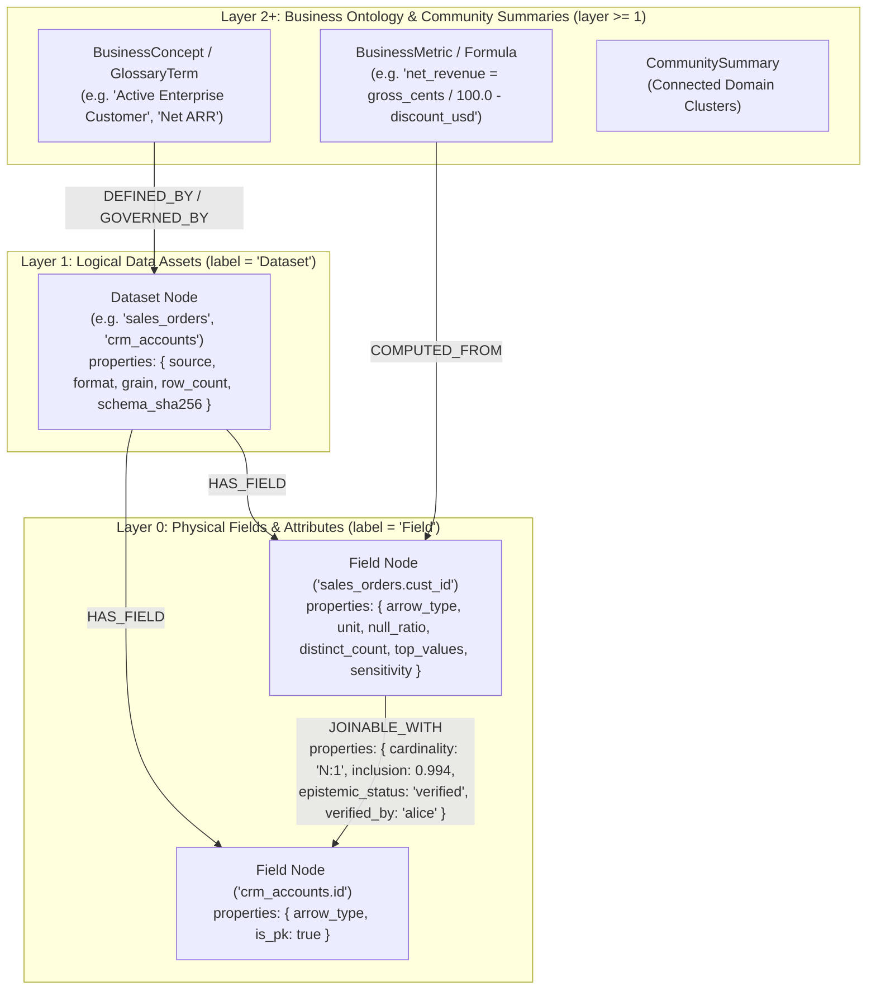
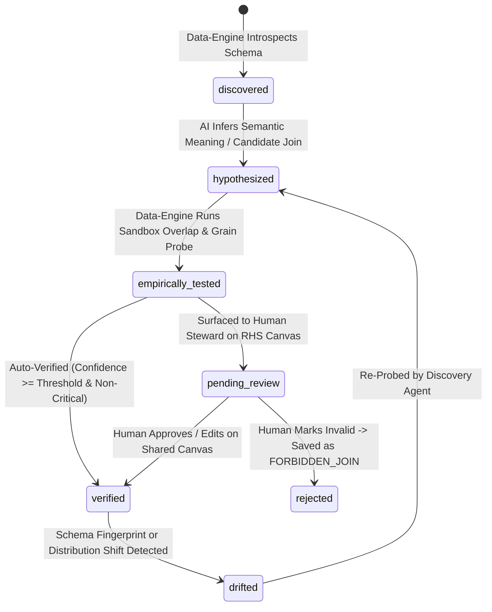

# Autonomous Semantic Layer & Data Asset Ontology PRD

## Overview
This PRD extends **GraphRAG-RS** beyond narrative Markdown knowledge extraction to serve as the **Autonomous Semantic Layer & Business Ontology Graph** for the 5-repository PolecatWorks ecosystem (`Mfe-shell`, `Angry-agent`, `agent-as-data`, `Graphrag`, and `data-engine`).

Because human teams cannot manually maintain semantic layers across thousands of evolving datasets and columns ("Catalog Rot"), GraphRAG-RS stores both **narrative business knowledge** and **structured data ontology nodes/tuples** enriched with **Epistemic Statuses**, **Confidence Scores**, **Structured Metadata (`properties: JSONB`)**, and **Human Stewardship Attribution**. It works in tandem with [`data-engine`](https://github.com/PolecatWorks/data-engine) (which performs physical schema introspection, statistical profiling, and empirical DataFusion join probing) and [`Angry-agent`](https://github.com/PolecatWorks/Angry-agent) / [`agent-as-data`](https://github.com/PolecatWorks/agent-as-data) (which coordinate human-in-the-loop verification and query/algorithm synthesis).

---

## Three-Layer Data & Business Ontology Architecture



---

## Core Capabilities & Requirements

### 1. Epistemic Lifecycle, Confidence & Structured Properties on Graph Elements
To support provenance-critical reasoning and human-in-the-loop stewardship, `knowledge_objects` (Nodes) and `graph_tuples` (Edges) are extended with structured epistemic and domain metadata:

| Field | Target Table(s) | Type | Default | Description |
| :--- | :--- | :--- | :--- | :--- |
| `epistemic_status` | `knowledge_objects`, `graph_tuples` | `VARCHAR` | `'verified'` (for manual/doc ingest) or `'hypothesized'` | One of: `'discovered'`, `'hypothesized'`, `'empirically_tested'`, `'pending_review'`, `'verified'`, `'rejected'`, `'drifted'`. |
| `confidence` | `knowledge_objects`, `graph_tuples` | `FLOAT8` | `1.0` | Epistemic confidence score in `[0.0, 1.0]`. |
| `verified_by` | `knowledge_objects`, `graph_tuples` | `VARCHAR` (Nullable) | `NULL` | Identifier of the human steward or verification workflow that certified the element. |
| `properties` | `knowledge_objects`, `graph_tuples` | `JSONB` | `'{}'::jsonb` | Structured domain attributes (e.g., `arrow_data_type`, `unit`, `grain`, `cardinality`, `inclusion_ratio`, `filter_invariant`, `sample_values`, `sensitivity_tag`). |



---

### 2. Negative Constraints (`FORBIDDEN_JOIN`)
When a human steward rejects a proposed relationship (for example, confirming that `billing.user_id` and `marketing.user_id` belong to incompatible ID namespaces), the tuple is **never silently deleted**. Instead:
- Its `predicate` is updated to `FORBIDDEN_JOIN` (with `epistemic_status = "rejected"` and `properties.rejection_reason`).
- Graph traversal and join-path planning explicitly inspect `FORBIDDEN_JOIN` edges to block invalid joins and surface the steward's explanation in the reasoning trace.

---

### 3. Multi-Hop Join-Path & Subgraph Planner (`POST /ontology/join-path` & MCP `graphrag_find_join_path`)
When an agent in `agent-as-data` or `Angry-agent` needs to combine multiple business concepts or fields to answer a user question, it calls `POST /ontology/join-path` (or MCP tool `graphrag_find_join_path`):

- **Request Payload (`JoinPathRequest`)**:
  ```json
  {
    "question": "Calculate net revenue by customer region for active accounts",
    "seed_concepts_or_fields": ["net_revenue", "customer_region", "active_accounts"],
    "include_unverified": true,
    "min_confidence": 0.6
  }
  ```
- **Planner Execution Steps**:
  1. **Hybrid Seed Resolution**: Resolves `seed_concepts_or_fields` against Layer 2 (`BusinessConcept` / `BusinessMetric`), Layer 1 (`Dataset`), and Layer 0 (`Field`) nodes using hybrid 64-d `pgvector` similarity + keyword RRF.
  2. **Concept-to-Field Lowering**: Traverses `DEFINED_BY`, `COMPUTED_FROM`, and `HAS_FIELD` edges to identify the physical `Dataset` and `Field` nodes required.
  3. **Steiner Join-Path Search**: Computes the highest-confidence connecting path across `JOINABLE_WITH` edges between the candidate datasets while excluding any `FORBIDDEN_JOIN` edges.
  4. **Fan-Out & Chasm Trap Analysis**: Inspects the `cardinality` (`1:1`, `1:N`, `N:1`, `N:M`) along the discovered join path. If a path traverses $A \xrightarrow{1:N} B$ and $A \xrightarrow{1:N} C$, emits a `fan_out_warnings` entry instructing `data-engine` to pre-aggregate before joining.
  5. **Epistemic Trust Rollup**: Computes `all_rules_human_verified: bool`, `min_confidence: f64`, and lists any `pending_review` or `hypothesized` nodes/edges used so the calling agent can either ask the user for confirmation or display a provenance badge.

---

### 4. Dataset, Profile & Epistemic Statistical Trait Synchronization (`POST /ontology/sync-dataset` & MCP `ontology_sync_dataset`)
Provides a single idempotent bulk upsert endpoint called by `data-engine` after profiling a dataset, probing a join hypothesis, or running statistical diagnostics (`stat_describe_and_check`, `stat_hypothesis_test`, `stat_timeseries_analyze`):
- Upserts the Layer 1 `Dataset` node, all Layer 0 `Field` nodes, `(Dataset) -[HAS_FIELD]-> (Field)` tuples, and any probed `(LeftField) -[JOINABLE_WITH]-> (RightField)` tuples.
- **Persistent Epistemic Statistical Traits (`properties.statistical_profile`)**: Persists learned statistical properties on `Field` and `Dataset` nodes inside `properties: JSONB`:
  - `distribution_family` (e.g., `"normal"`, `"log_normal_heavy_tailed"`, `"bimodal"`, `"zero_inflated"`)
  - `is_heavy_tailed` (`bool`), `skewness` (`f64`), `kurtosis` (`f64`)
  - `seasonality_period` (nullable string/int, e.g., `"7d"`, `"12m"`)
  - `recommended_test_family` (e.g., `"non_parametric_or_log_transform"`, `"welch_t"`, `"first_differenced_ts"`)
  - `known_confounders` (array of field canonical IDs, e.g., `["customers.segment"]`, enabling automatic stratification hints against Simpson's paradox)
  - `last_diagnosed_run_id` (`ProvenanceRun` UUID from `data-engine`)
- Follows the exact same epistemic lifecycle (`empirically_tested` $\rightarrow$ `pending_review` $\rightarrow$ `verified` / `drifted`): preserves existing human-curated descriptions, `statistical_profile` caveats, and `verified` statuses unless `epistemic_status = "drifted"` is explicitly signaled by a schema fingerprint or distribution shift.
- **Surfaced in Join-Path Planning**: `POST /ontology/join-path` (`graphrag_find_join_path`) automatically attaches `statistical_caveats` (any `statistical_profile` and `known_confounders` on participating `Dataset` and `Field` nodes) to the returned subgraph so `AppliedStatistician` agents know distributional constraints and confounders *before* selecting statistical tests.
- Recomputes 64-d `pgvector` embeddings and refreshes Layer 1+ `CommunitySummary` clusters.

---

### 5. Ontology Discovery & Benchmark Validation Datasets
To empirically verify that **GraphRAG-RS** and [`data-engine`](https://github.com/PolecatWorks/data-engine) accurately infer semantic layers, detect fan-out/chasm traps, and honor `FORBIDDEN_JOIN` negative constraints, the ontology graph is benchmarked against three validation tiers (detailed in `data-engine`'s `validation-datasets-and-benchmark-prd.md`):

1. **Valentine Schema & Join Discovery Benchmark ([`delftdata/valentine`](https://github.com/delftdata/valentine))**:
   - Ingests Valentine's ground-truth `Joinable`, `Unionable`, and `View-Union` dataset pairs (where column names are intentionally obfuscated or noisy) via `POST /ontology/sync-dataset`.
   - Measures **Join Edge Precision, Recall, and F1** of `JOINABLE_WITH` tuples and verifies that semantic community clustering (`CommunitySummary`) groups fragmented tables into the right domain clusters.
2. **BIRD-SQL (`bird-bench.github.io` / `birdsql/bird_mini_dev`) Blind-Evidence Protocol**:
   - Ingests BIRD-SQL's 95 dirty multi-table databases *without* their `evidence` annotations so `data-engine` + `Graphrag` hypothesize `Field` semantics, units, and `JOINABLE_WITH` edges (`epistemic_status = "hypothesized"` / `"empirically_tested"`).
   - Simulates Human Steward review on the RHS Shared Canvas using the held-back BIRD-SQL `evidence` rules to transition nodes/tuples to `verified` (or `FORBIDDEN_JOIN`), quantifying the accuracy delta on `POST /ontology/join-path`.
3. **Brazilian E-Commerce by Olist & Built-In Chaos Seeder (`TRAP-01` .. `TRAP-04`)**:
   - Validates that `POST /ontology/join-path` blocks the `TRAP-01` homonym chasm (`billing_subscriptions.account_id` vs `marketing_leads.account_id`) once marked `FORBIDDEN_JOIN`, discovers the `TRAP-02` cryptic synonym join (`sales_orders.cust_ref_key` $\leftrightarrow$ `crm_customers.party_uuid`), and emits `fan_out_warnings` on the `TRAP-03` ($2.45\times$ `order_items` $\times$ `order_payments`) M:N fan-out trap.

---

## Related PRDs
- [Graph RAG PRD](./graph-rag-prd.md)
- [Graph RAG Data Management (BREAD API) PRD](./graph-rag-api-bread-prd.md)
- [Graph RAG MCP Service PRD](./graph-rag-mcp-prd.md)

