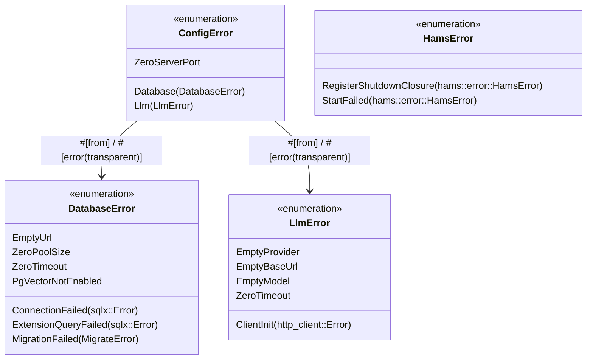
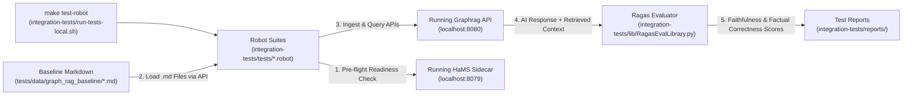
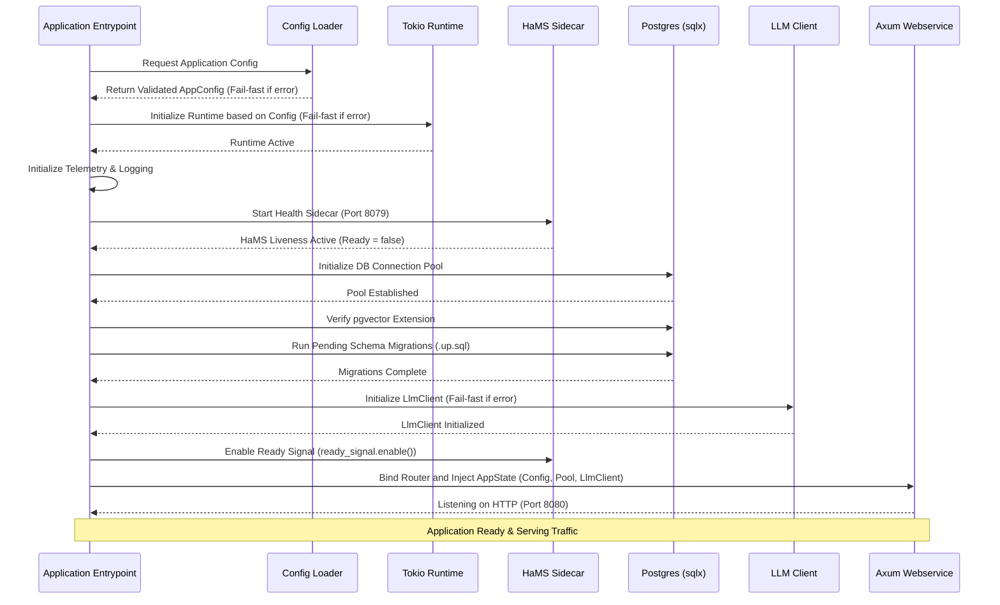

# Backend Foundations Product Requirements Document (PRD)

## Overview
This PRD outlines the architectural foundations and standard patterns for the Rust backend microservice based on the `agent-as-data` model. The purpose of this architecture is to provide a robust, observable, and fail-fast backend service utilizing Rust, Axum, PostgreSQL (with pgvector), and a dedicated health monitoring sidecar (HaMS).

## System Architecture

```mermaid
flowchart TD
    subgraph "External"
        Client[Web Client / API Consumers]
        LLM[LLM API Services]
    end

    subgraph "Backend Container"
        ConfigLoader[AppConfig Loader\n(YAML + Env)]

        subgraph "Application Core (Rust)"
            Axum[Axum REST API]
            LLMTools[LLM Tools / Integrations]
            State[App State\n(Connection Pools & Config)]
        end

        HaMS[HaMS\n(Health Monitoring Sidecar)]
    end

    subgraph "Data Storage"
        Postgres[(PostgreSQL)]
        PgVector[pgvector Extension]
        Postgres --- PgVector
    end

    Client -->|HTTP Requests| Axum
    Axum <--> State
    State <--> LLMTools
    LLMTools <-->|External Calls| LLM
    State <-->|SQLx Connection Pool| Postgres
    HaMS -->|Metrics / Health Probes| Client
    ConfigLoader -->|Injects Validated Config| State
```

## Core Components & Requirements

### 0. Developer Tooling (Make)
**Objective:** Provide ergonomic syntactic sugar for common development actions.
- A root-level `Makefile` exposes targets to simplify the build, test, and run cycles.
- Targets should include: `make dev` (start server with port cleanup), `make watch` (hot-reloading via cargo watch), `make migrate`, `make test` (unit tests), and `make test-robot` (execute Robot Framework integration tests via `./integration-tests/run-tests-local.sh` against the already-running Graphrag service).

### 1. Configuration Loading & Typed Error Hierarchy
**Objective:** Guarantee that the application operates only with valid, well-formed configuration and structured, inspectable error types, failing immediately upon startup if any properties are missing or invalid.
- **CLI Argument Parsing (`clap` Derive):** Command-line arguments (e.g., `-c` / `--config <FILE>`) must be defined in `src/cli.rs` using `clap` with the `derive` feature (`#[derive(clap::Parser)]`, `#[derive(clap::Subcommand)]`, `#[derive(clap::Args)]`) rather than manual argument parsing or imperative builder chains.
- **Centralized Loader:** All application configuration must be loaded into strongly typed structs at startup (e.g., via `config` or `figment` crate), taking the optional config path parsed by `Cli::parse()`.
- **Modular Config Ownership & Delegated Validation:** Each domain module (`db`, `llm_tools`, etc.) defines and owns its specific configuration struct (`DatabaseConfig`, `LlmConfig`), implements its own `.validate()` method returning its domain `thiserror::Error` enum (`DatabaseError`, `LlmError`), and maintains unit tests covering its field-level validation rules. The central `AppConfig` composes these domain structs, validates top-level server properties, and delegates domain validation to each subsystem (`self.database.validate()?`, `self.llm.validate()?`) into `ConfigError` via `#[error(transparent)]`.
- **No Stringly-Typed Errors (`Result<_, String>`):** All modules (`config`, `db`, `llm_tools`, `hams_tools`) must use strongly typed `thiserror::Error` enums (`ConfigError`, `DatabaseError`, `LlmError`, `HamsError`) instead of `String` errors.
- **Fail-Fast Validation:** The system must validate the configuration scheme before establishing database connections or binding network listeners.
- **Zero Direct Runtime Environment Variables:** Accessing environment variables directly in business logic (e.g., `std::env::var`) is strictly prohibited. All environment variables must be loaded and merged into the central `AppConfig` at startup.
- **No Hardcoded Defaults in Logic:** Hardcoded fallback values in handlers or execution paths are not allowed.



### 2. Async Runtime Execution (Tokio)
**Objective:** Control the execution environment of the application deterministically via configuration.
- **Configurable Runtime:** The Tokio runtime must be initialized using parameters loaded from the centralized `AppConfig` (e.g., under a `runtime` key).
- **Thread Management:** The number of worker threads must be configurable.
  - Setting threads to `0` configures a single-threaded runtime (`new_current_thread`).
  - Setting threads to `> 0` configures a multi-threaded runtime (`new_multi_thread`) with the specified number of workers.
- **Additional Parameters:** Configuration should also support defining:
  - `stack_size`: Thread stack size in bytes.
  - `name`: Name prefix assigned to worker threads (e.g., for debugging and tracing).
  - `metrics_interval`: Interval for Tokio metrics reporting.
- **Fail-Fast Initialization:** If the runtime fails to build (e.g., due to invalid thread parameters), the application must fail-fast and panic immediately upon startup.
- **Isolation:** All long-running async tasks, including migrations and the main web service, must run within this explicitly configured runtime.

### 3. Database & Storage Layer
**Objective:** Manage structured relational data and high-dimensional vector embeddings safely and predictably.
- **Domain Configuration & Error Type (`DatabaseConfig`, `DatabaseError`):** The `db` module (`src/db.rs`) owns `DatabaseConfig` (`url`, `pool_size`, `timeout_seconds`), `DatabaseError` (`thiserror::Error`), its `.validate() -> Result<(), DatabaseError>` implementation, and unit tests for database configuration validation.
- **PostgreSQL Connection Pool:** Application state must maintain a connection pool (via `sqlx`) to PostgreSQL (`init_db(&DatabaseConfig) -> Result<PgPool, DatabaseError>`).
- **pgvector Integration:** The backend must support vector operations (e.g., semantic search) and must explicitly verify the existence of the `pgvector` extension during the application startup process.
- **Automatic Migrations:** Database schema definitions are represented as `.up.sql` migration scripts. The application must run these migrations automatically and sequentially upon startup before serving traffic.

### 4. Axum Web Service
**Objective:** Serve scalable and performant REST APIs.
- **Framework:** The primary webservice will utilize `Axum` built on top of the Tokio async runtime.
- **App State Injection:** The webservice must receive a shared `AppState` containing the database connection pool, metrics recorder, and read-only configuration context.
- **Routing & Handlers:** Routes should be declarative and well-separated into functional domain modules.

### 5. Health Monitoring Sidecar (HaMS)
**Objective:** Decouple application health reporting and metric telemetry from the primary business logic webservice.
- **Sidecar Process & Typed Errors (`HamsError`):** The backend utilizes the external `hams` crate to run a separate sidecar listener (typically on a dedicated port like `8079`), configured via a nested `hams` block in the YAML config. `HamsHarness::init` in `src/hams_tools.rs` returns a typed `Result<Self, HamsError>` derived via `thiserror::Error` rather than `Result<Self, String>`.
- **Telemetry & Probes:** HaMS provides out-of-the-box endpoints for Kubernetes-style liveness and readiness probes, and exposes Prometheus metrics.
- **Lifecycle Integration:** The sidecar starts immediately after configuration validation but before DB connections are made. Once both the database connection and the LLM client are verified/initialized, the system marks the HaMS ready signal to true.
- **Graceful Shutdown:** The system integrates a `CancellationToken` that HaMS triggers on shutdown. The primary Axum server listens for this token cancellation to perform a graceful HTTP server shutdown.

### 6. LLM Tools Integration
**Objective:** Provide internal abstractions for connecting to, prompting, and orchestrating Large Language Models.
- **Interfaces:** The backend must include tools (`llm_tools`) that abstract API requests to LLMs (e.g., OpenAI, Anthropic, or local models).
- **Domain Configuration & Error Type (`LlmConfig`, `LlmError`):** The `llm_tools` module (`src/llm_tools.rs`) owns `LlmConfig` (`provider`, `base_url`, `api_key`, `model`, `timeout_seconds`), `LlmError` (`thiserror::Error`), its `.validate() -> Result<(), LlmError>` implementation, and unit tests for LLM configuration validation. `AppConfig` composes `LlmConfig` and delegates validation to `self.llm.validate()?`.
- **Fail-Fast Client Initialization:** `LlmClient::new(&config.llm) -> Result<Self, LlmError>` must be initialized during startup without `.unwrap()`. Any client initialization error must be logged via `tracing::error!` and terminate startup with a non-zero exit code (`process::exit(1)`) before the HaMS readiness signal is enabled.

### 7. Integration Testing (`make test-robot` / Robot Framework + Ragas)
**Objective:** Validate end-to-end service behavior, API contracts, health/metrics probes, markdown ingestion, and AI query responses against the already-running Graphrag service using Robot Framework and **Ragas**.
- **Pre-Running Service Assumption:** When `make test-robot` is invoked, the Graphrag backend (and its backing PostgreSQL + LLM endpoints) is expected to already be running (e.g. via `make watch` / `make dev` or in a container environment). The Robot Framework runner does not boot the Rust server itself; it verifies readiness via HaMS (`/health/ready`) and then executes tests directly against the live HTTP APIs.
- **Integration Test Suite (`integration-tests/`):** All integration and end-to-end journey tests are provided as Robot Framework suites (`integration-tests/tests/*.robot`), invoked via `make test-robot` (`./integration-tests/run-tests-local.sh`) and outputting HTML/XML reports to `integration-tests/reports/`.
- **End-to-End Ingestion & Ragas AI Response Evaluation:**
  - The Robot tests load the baseline `.md` files (`tests/data/graph_rag_baseline/*.md`) into Graphrag via its ingestion API.
  - The tests then issue natural-language and multi-hop queries against the Graphrag query APIs and evaluate the responses using **Ragas** wrapped in a custom Robot Framework keyword library (`integration-tests/lib/RagasEvalLibrary.py`), asserting on RAG metrics such as **Faithfulness**, **Factual Correctness**, **Response Relevancy**, and **Context Recall**.
  - Every test case cleans up its ingested test data in `[Teardown]` hooks so the database remains clean across runs.



## Application Startup Lifecycle



## Related Standards
For development conventions, PR branch guidelines, and server watch mechanics, please refer to the `AGENTS.md` guidelines at the repository root.


