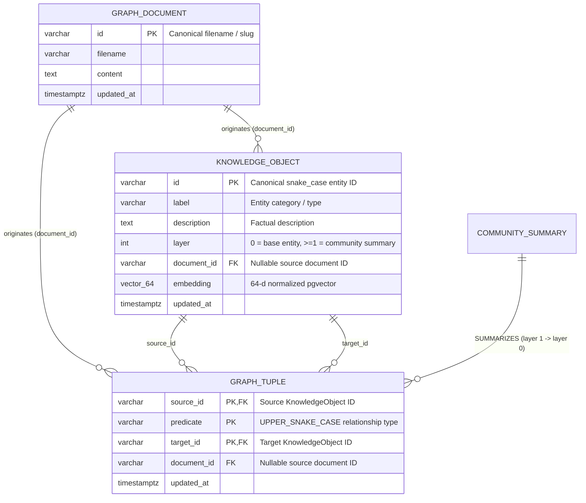
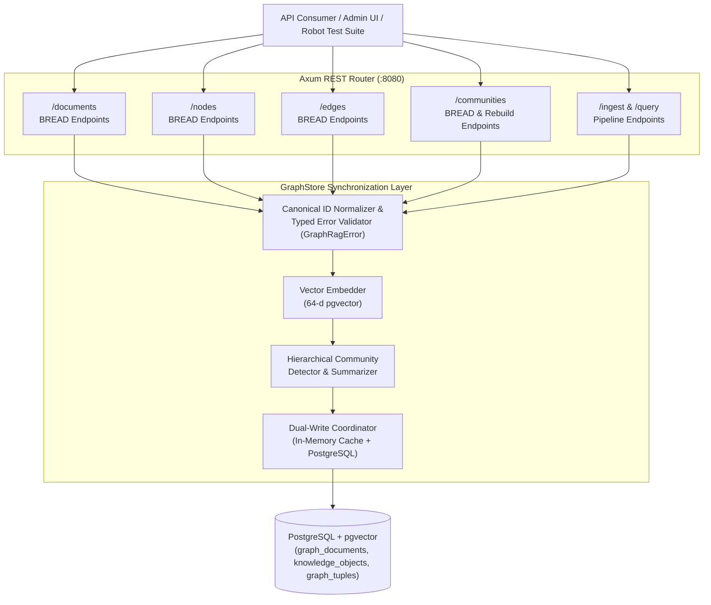
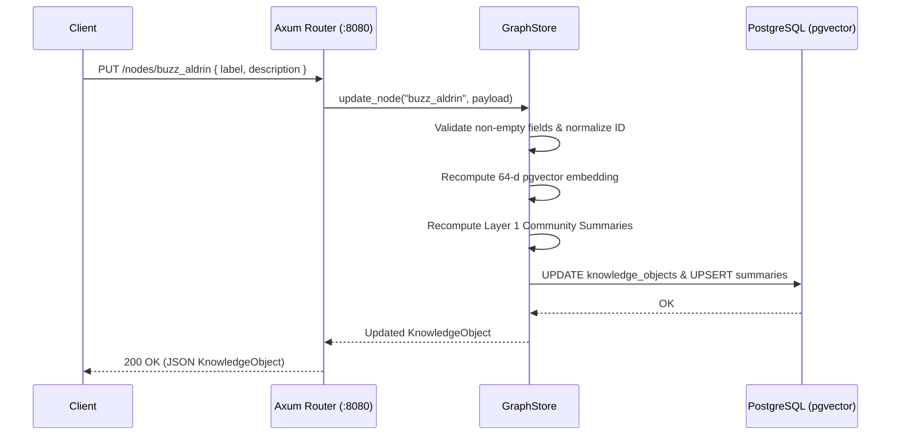

# Graph RAG Data Management (BREAD API) Product Requirements Document (PRD)

## Overview
This PRD defines the **Browse, Read, Edit, Add, Delete (BREAD)** REST API requirements for directly managing all core data elements in **GraphRAG-RS**:
1. **Documents (`graph_documents`)**: Raw Markdown source documents and their ingestion lifecycle.
2. **Knowledge Objects / Nodes (`knowledge_objects`)**: Extracted or manually curated graph entities and their `pgvector` embeddings.
3. **Graph Tuples / Edges (`graph_tuples`)**: Directed `(source, predicate, target)` relationships connecting Knowledge Objects.
4. **Communities / Hierarchical Summaries (`layer >= 1` nodes & `SUMMARIZES` edges)**: Clustered community summary nodes used for global and multi-hop queries.

While the pipeline endpoints (`POST /ingest` and `POST /query` in [Graph RAG PRD](./graph-rag-prd.md)) provide automated end-to-end document ingestion and RAG question answering, external clients, administrative UIs, and automated test suites require fine-grained **BREAD** operations to inspect, curate, patch, and prune individual graph elements without re-ingesting entire corpora.

---

## Domain Model & Resource Hierarchy

---

## High-Level API Architecture

---

## Core Resource BREAD Requirements

### 1. Documents Resource (`/documents`)

Manages source Markdown documents (`graph_documents`) and coordinates cascading updates to extracted nodes and edges.

| BREAD Operation | HTTP Method & Route | Success Status | Description |
|---|---|---|---|
| **Browse** | `GET /documents` | `200 OK` | Lists ingested documents with optional query parameters (`?limit=50&offset=0&q=<filename_filter>`), returning document metadata (`id`, `filename`, `updated_at`, `node_count`, `edge_count`). |
| **Read** | `GET /documents/{id}` | `200 OK` | Returns the full document (`id`, `filename`, `content`, `updated_at`) along with the list of `KnowledgeObject` IDs and `GraphTuple` edges associated with `document_id`. Returns `404 Not Found` if absent. |
| **Edit** | `PUT /documents/{id}` | `200 OK` | Replaces a document's `content` (and optional `filename`), removes stale entities exclusive to the previous version of the document, re-runs chunking and extraction, and refreshes Layer 1 community summaries. Returns `404 Not Found` if the document does not exist. |
| **Add** | `POST /documents` | `201 Created` | Ingests a new Markdown document (`{ "filename": "...", "content": "..." }`), extracts Knowledge Objects and Graph Tuples, and computes Layer 1 summaries. (`POST /ingest` remains supported as an idempotent alias returning `200 OK`). |
| **Delete** | `DELETE /documents/{id}` | `204 No Content` | Deletes the document, removes associated nodes and edges where `document_id = id`, and recomputes Layer 1 community summaries. |

---

### 2. Knowledge Objects / Nodes Resource (`/nodes`)

Provides direct management of graph vertices (`knowledge_objects`) across Layer 0 (base entities) and Layer 1+ (community summaries).

| BREAD Operation | HTTP Method & Route | Success Status | Description |
|---|---|---|---|
| **Browse** | `GET /nodes` | `200 OK` | Lists Knowledge Objects with optional filtering (`?label=Astronaut&layer=0&document_id=03_buzz_aldrin.md&q=MIT&limit=50&offset=0`). Supports semantic similarity ranking when `?semantic_query=<text>` is supplied. |
| **Read** | `GET /nodes/{id}` | `200 OK` | Retrieves a single `KnowledgeObject` by its canonical `id` (`id`, `label`, `description`, `layer`, `document_id`, `updated_at`), plus its `outgoing_edges` and `incoming_edges`. Returns `404 Not Found` if absent. |
| **Edit** | `PUT /nodes/{id}` | `200 OK` | Updates an existing Knowledge Object's `label`, `description`, `layer`, or `document_id`. Automatically recomputes the 64-d `pgvector` embedding from the updated fields and refreshes Layer 1 community summaries. Returns `404 Not Found` if absent. |
| **Add** | `POST /nodes` | `201 Created` | Creates or upserts a Knowledge Object (`{ "id": "apollo_12", "label": "Mission", "description": "...", "layer": 0, "document_id": null }`). Normalizes `id` to `snake_case`, generates its 64-d `pgvector` embedding, persists to PostgreSQL and `GraphStore`, and updates community summaries. |
| **Delete** | `DELETE /nodes/{id}` | `204 No Content` | Deletes the Knowledge Object by `id`, cascade-deletes all incident `GraphTuple` edges (`source_id = id` or `target_id = id`), and refreshes Layer 1 community summaries. Returns `404 Not Found` if the node does not exist. |

---

### 3. Graph Tuples / Edges Resource (`/edges`)

Provides direct management of directed relationships (`graph_tuples`) between Knowledge Objects.

| BREAD Operation | HTTP Method & Route | Success Status | Description |
|---|---|---|---|
| **Browse** | `GET /edges` | `200 OK` | Lists Graph Tuples with optional filtering (`?source=michael_collins&predicate=PILOTED&target=command_module_columbia&document_id=04_michael_collins.md&limit=100&offset=0`). |
| **Read** | `GET /edges/{source}/{predicate}/{target}` | `200 OK` | Retrieves a specific directed edge by its composite key `(source, predicate, target)` along with brief summaries of the source and target nodes. Returns `404 Not Found` if absent. |
| **Edit** | `PUT /edges/{source}/{predicate}/{target}` | `200 OK` | Updates an existing edge's `predicate`, `target`, or `document_id` (atomically replacing the composite key if `predicate` or `target` changed) and refreshes Layer 1 community clustering. Returns `404 Not Found` if the original edge does not exist. |
| **Add** | `POST /edges` | `201 Created` | Creates a directed edge (`{ "source": "neil_armstrong", "predicate": "COMMANDED", "target": "apollo_11", "document_id": null }`). Validates that both `source` and `target` nodes exist (returning `400 Bad Request` / `404 Not Found` if missing unless `auto_create_nodes: true` is specified) and refreshes Layer 1 communities. |
| **Delete** | `DELETE /edges/{source}/{predicate}/{target}` | `204 No Content` | Deletes the specified directed edge `(source, predicate, target)` from PostgreSQL and `GraphStore`, and refreshes Layer 1 community clustering. Returns `404 Not Found` if absent. |

---

### 4. Communities & Hierarchical Summaries Resource (`/communities`)

Provides visibility and control over Layer 1+ community clustering (`label = "CommunitySummary"`, `layer >= 1`) and `SUMMARIZES` hierarchy edges.

| BREAD Operation | HTTP Method & Route | Success Status | Description |
|---|---|---|---|
| **Browse** | `GET /communities` | `200 OK` | Lists all Layer 1+ `CommunitySummary` nodes along with their `member_node_ids` and `member_count`. |
| **Read** | `GET /communities/{id}` | `200 OK` | Retrieves a single community summary (`id`, `description`, `layer`, `member_nodes`, `edges`). Returns `404 Not Found` if absent. |
| **Edit** | `PUT /communities/{id}` | `200 OK` | Updates a community's summary `description`, recomputing its 64-d `pgvector` embedding. Returns `404 Not Found` if absent. |
| **Add / Rebuild** | `POST /communities/rebuild` | `200 OK` | Re-runs community detection and hierarchical summarization across all current Layer 0 nodes and edges, returning the newly generated `CommunitySummary` list. |
| **Delete** | `DELETE /communities/{id}` | `204 No Content` | Deletes a community summary node and its outgoing `SUMMARIZES` hierarchy edges. |

---

## Mutation & Synchronization Sequence

---

## Cross-Cutting Architectural & Quality Requirements

### 1. Canonical Identifier Normalization
- Node IDs (`id`, `source`, `target`) must be normalized via `normalize_entity_id` to lowercase `snake_case`.
- Edge predicates (`predicate`) must be normalized to `UPPER_SNAKE_CASE`.
- Path parameters in `/nodes/{id}` and `/edges/{source}/{predicate}/{target}` must be normalized before lookup so clients can pass either `"Michael Collins"` (URL-encoded) or `"michael_collins"`.

### 2. Referential Integrity & Cascading Rules
- Deleting a `KnowledgeObject` (`DELETE /nodes/{id}`) must cascade-delete all `GraphTuple` edges where `source_id = id` or `target_id = id` before recomputing Layer 1 communities.
- Deleting or editing a `Document` (`DELETE /documents/{id}`, `PUT /documents/{id}`) must clean up nodes and edges attributed to that `document_id` and recompute Layer 1 communities.
- Creating an edge (`POST /edges`) referencing a non-existent `source` or `target` node must fail with a typed `GraphRagError::NodeNotFound(String)` mapped to HTTP `404 Not Found` (unless `auto_create_nodes` is explicitly requested).

### 3. Typed Error Handling (`thiserror`)
- In accordance with [AGENTS.md](../../AGENTS.md), all BREAD operations in `src/graph_rag.rs` must return `Result<T, GraphRagError>` where `GraphRagError` derives `thiserror::Error` (`Result<_, String>` is strictly prohibited).
- Specific error variants must map cleanly to HTTP status codes in `src/routes.rs`:
  - `GraphRagError::DocumentNotFound(String)` $\rightarrow$ `404 Not Found`
  - `GraphRagError::NodeNotFound(String)` $\rightarrow$ `404 Not Found`
  - `GraphRagError::EdgeNotFound { source, predicate, target }` $\rightarrow$ `404 Not Found`
  - `GraphRagError::CommunityNotFound(String)` $\rightarrow$ `404 Not Found`
  - Validation errors (`EmptyFilename`, `EmptyMarkdownContent`, `EmptyNodeId`, `EmptyNodeLabel`, `EmptyPredicate`) $\rightarrow$ `400 Bad Request`
  - Database / LLM transport errors $\rightarrow$ `500 Internal Server Error`

### 4. End-to-End Integration Testing (`make test-robot` + Ragas)
- Extend the Robot Framework integration test harness (`integration-tests/lib/GraphragApiLibrary.py` and `integration-tests/tests/03_graph_rag_bread_api.robot`) executed via `make test-robot` to:
  1. Exercise **Browse, Read, Edit, Add, Delete** across `/documents`, `/nodes`, `/edges`, and `/communities`.
  2. Verify that adding or editing nodes/edges via the BREAD API immediately reflects in subsequent `POST /query` answers graded by **Ragas** (`RagasEvalLibrary.py`).
  3. Verify that deleting nodes/edges/documents returns `404 Not Found` on subsequent reads and cleans up all test artifacts in `[Teardown]`.

### 5. Model Context Protocol (MCP) Parity
- All BREAD operations defined in this PRD are also exposed as structured MCP tools (`document_*`, `node_*`, `edge_*`, `community_*`) over HTTP JSON-RPC 2.0 (`POST /mcp`, `POST /api/v1/mcp`). See the **[Graph RAG MCP Service PRD](./graph-rag-mcp-prd.md)** for the MCP tool router specification.

