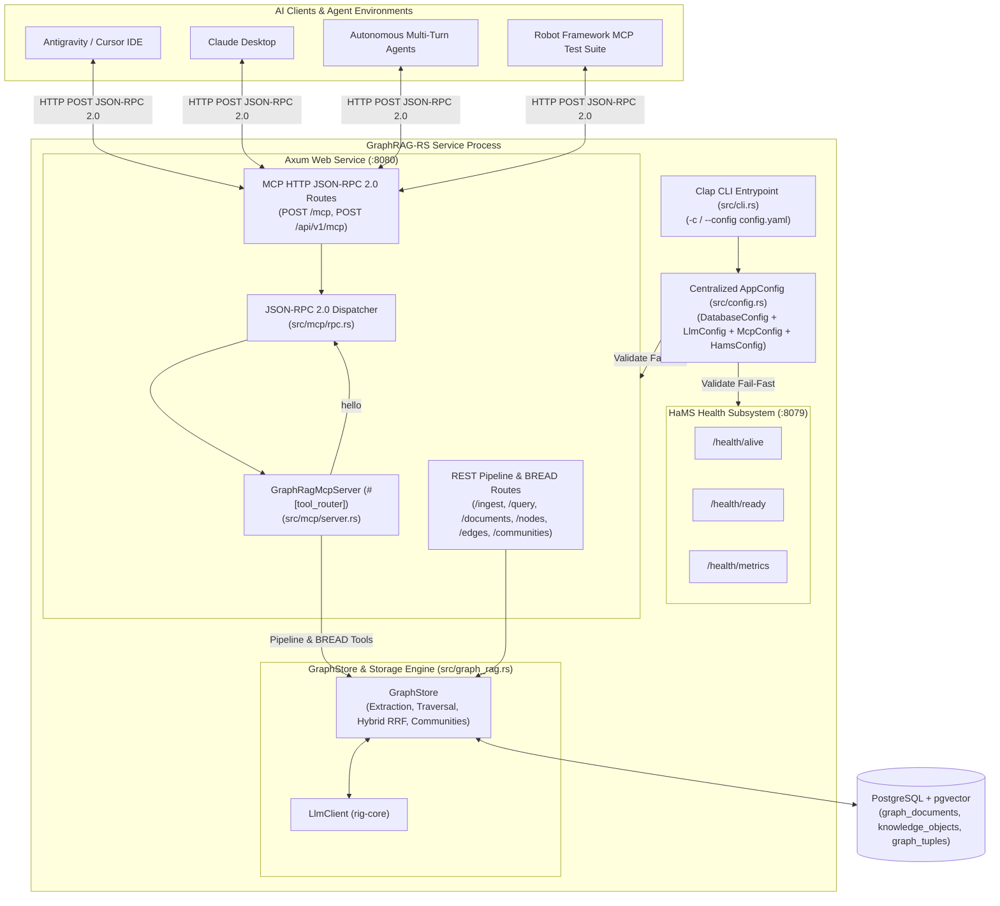
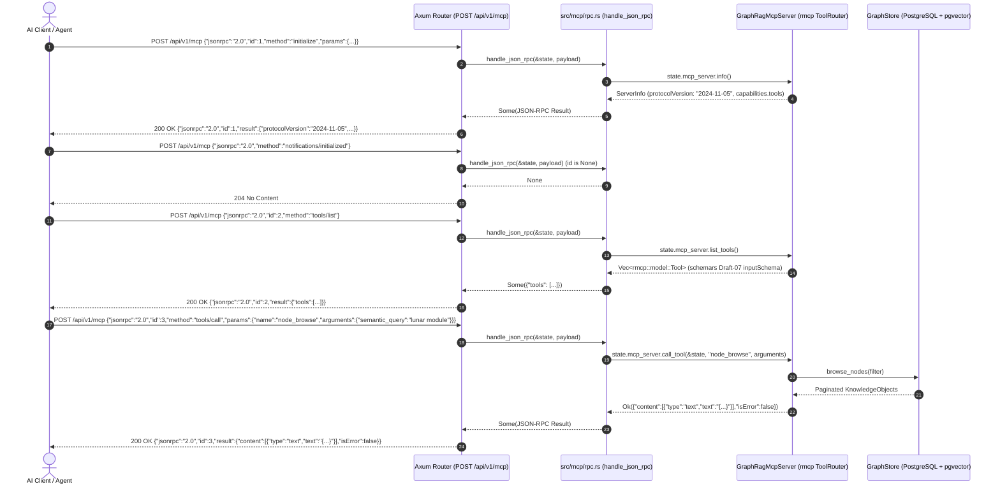
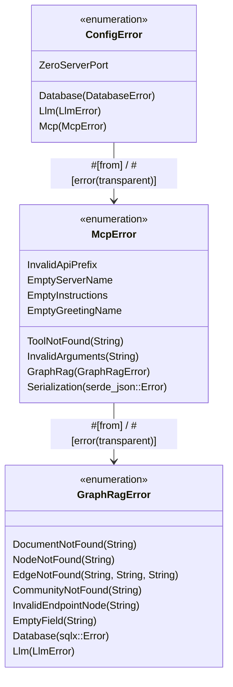
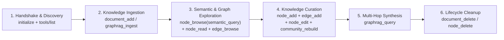

# Graph RAG Model Context Protocol (MCP) Service PRD

## Overview
This PRD defines the requirements, architecture, protocol lifecycle, and tool contracts for exposing **GraphRAG-RS** via the **Model Context Protocol (MCP)**, following the established patterns of [`aad-mcp-container`](https://github.com/PolecatWorks/agent-as-data/tree/main/aad-mcp-container) in the `agent-as-data` ecosystem.

By exposing GraphRAG-RS as an MCP server over standard HTTP JSON-RPC 2.0 transport (`/mcp` and `/api/v1/mcp`), AI clients—including IDEs (Antigravity, Cursor), desktop assistants (Claude Desktop), and autonomous multi-turn agents—can discover and invoke structured tools to:
1. Verify connectivity via the canonical **`hello`** smoke-test tool.
2. Execute end-to-end **Graph RAG Pipeline** operations (`graphrag_ingest`, `graphrag_query`).
3. Perform full **BREAD (Browse, Read, Edit, Add, Delete)** management across all Graph RAG data elements (**Documents**, **Knowledge Objects / Nodes**, **Graph Tuples / Edges**, and **Layer 1+ Community Summaries**), mirroring the capabilities defined in the [Graph RAG Data Management (BREAD API) PRD](./graph-rag-api-bread-prd.md).

---

## Core Objectives

1. **Architectural Parity with `aad-mcp-container`**:
   - **`rmcp` + `schemars` Tool Router**: Use the `rmcp` crate (`#[tool_router]`, `#[tool]`, `#[tool_handler]`, `ServerHandler`, `ToolRouter<Self>`, `Parameters<T>`) together with `schemars::JsonSchema` on tool request structs to automatically generate strict Draft-07 JSON Schemas for `tools/list`.
   - **Direct HTTP JSON-RPC 2.0 Transport**: Expose stateless HTTP `POST` JSON-RPC 2.0 endpoints at `/mcp` and `${api_prefix}/v1/mcp` (default `/api/v1/mcp`) on the primary Axum server (`:8080`), processing `application/json` payloads directly without requiring stateful SSE sessions.
   - **Full MCP Lifecycle Compliance**: Support `initialize`, `notifications/initialized` (returning `204 No Content`), `ping`, `tools/list`, and `tools/call`.
2. **Strict Compliance with GraphRAG-RS Standards (`AGENTS.md`)**:
   - **Modular Config Ownership (`McpConfig`)**: Define `McpConfig` (`enabled`, `api_prefix`, `server_name`, `instructions`) in `src/mcp/mod.rs` with fail-fast validation (`.validate() -> Result<(), McpError>`) delegated from `AppConfig::validate()` in `src/config.rs`.
   - **Typed Error Hierarchy (`McpError`)**: Use `thiserror::Error` for all internal MCP configuration and execution errors (`McpError`, wrapping `GraphRagError` via `#[from]` / `#[error(transparent)]`). Zero `Result<_, String>` in domain logic and zero runtime `std::env::var` calls.
   - **In-Process `AppState` Sharing**: Inject `AppState` (`PgPool`, `LlmClient`, `GraphStore`, `GraphRagMcpServer`) directly into the MCP dispatcher so MCP tool calls execute in-process against `GraphStore` and PostgreSQL (`pgvector`) with zero network hop overhead.
3. **Baseline Verification Tool (`hello`)**:
   - Provide the canonical `hello` tool accepting `{ "name": "<string>" }`, trimming surrounding whitespace, rejecting empty/whitespace-only names with `isError: true`, and returning `"Hello, <name>!"`.
4. **Complete Graph RAG Pipeline & BREAD Tool Coverage**:
   - Expose structured MCP tools for pipeline execution (`graphrag_ingest`, `graphrag_query`) and full BREAD operations over Documents (`document_*`), Nodes (`node_*`), Edges (`edge_*`), and Communities (`community_*`).

---

## System Architecture & Runtime Lifecycle



---

## MCP Protocol Lifecycle & Sequence Flow

The MCP HTTP JSON-RPC 2.0 subsystem implements the exact request/response handshake and tool invocation lifecycle used in `aad-mcp-container`:



---

## Configuration & Typed Error Architecture

### 1. Modular Configuration (`McpConfig`)
In accordance with `AGENTS.md`, the `mcp` module (`src/mcp/mod.rs`) defines and validates `McpConfig`:

```yaml
mcp:
  enabled: true
  api_prefix: "/api"
  server_name: "graphrag-mcp"
  instructions: "GraphRAG-RS Model Context Protocol Server for knowledge graph ingestion, hybrid RAG querying, and BREAD data management."
```

- **Environment Variable Overrides**: Configurable via `APP_MCP__ENABLED`, `APP_MCP__API_PREFIX`, `APP_MCP__SERVER_NAME`, and `APP_MCP__INSTRUCTIONS`.
- **Fail-Fast Validation Rules (`McpConfig::validate() -> Result<(), McpError>`)**:
  - When `enabled` is `true`:
    - `api_prefix` must be non-empty and start with `'/'` (`McpError::InvalidApiPrefix`).
    - `server_name` must be non-empty after trimming (`McpError::EmptyServerName`).
    - `instructions` must be non-empty after trimming (`McpError::EmptyInstructions`).

### 2. Typed Error Hierarchy (`McpError`)


### 3. JSON-RPC 2.0 Error vs. MCP Tool Error Mapping
Following the MCP specification and `aad-mcp-container` conventions:
- **JSON-RPC Protocol Errors** return a JSON-RPC `error` object:
  - Missing `"method"` field in request $\rightarrow$ `code: -32600` (`"Invalid Request: missing method"`).
  - Unrecognized JSON-RPC `"method"` $\rightarrow$ `code: -32601` (`"Method '<method>' not found"`).
  - Missing `"name"` inside `tools/call` `"params"` $\rightarrow$ `code: -32602` (`"Invalid params: 'name' is required"`).
- **Tool Execution & Validation Errors** (`McpError::ToolNotFound`, `McpError::InvalidArguments`, `McpError::EmptyGreetingName`, `McpError::GraphRag(_)`) return HTTP `200 OK` with a standard MCP tool result envelope setting `"isError": true`:
  ```json
  {
    "jsonrpc": "2.0",
    "id": 5,
    "result": {
      "content": [
        {
          "type": "text",
          "text": "Error: Node 'unknown_entity' not found"
        }
      ],
      "isError": true
    }
  }
  ```

---

## MCP Tool Catalog & Specifications

All tools are registered on `GraphRagMcpServer` using `#[tool_router]` and `#[tool(description = "...")]` with request structs deriving `#[derive(Debug, Clone, Deserialize, Serialize, schemars::JsonSchema)]`.

### 1. Baseline Smoke-Test Tool (`hello`)

| Tool Name | Request Schema Struct | Required Fields | Optional Fields | Description |
|---|---|---|---|---|
| `hello` | `HelloRequest` | `name: String` | — | Generates a friendly greeting response (`"Hello, <name>!"`) for a specified user or entity name. Trims leading/trailing whitespace and rejects empty/whitespace-only strings with `isError: true`. |

---

### 2. Graph RAG Pipeline Tools (`graphrag_*`)

| Tool Name | Request Schema Struct | Required Fields | Optional Fields | Description |
|---|---|---|---|---|
| `graphrag_ingest` | `GraphRagIngestRequest` | `filename: String`, `content: String` | — | Ingests a raw Markdown document into the knowledge graph, performing semantic chunking, entity/relationship extraction, 64-d `pgvector` embedding, and Layer 1 community summarization. Returns `{ document_id, chunks_processed, nodes_extracted, edges_extracted }`. |
| `graphrag_query` | `GraphRagQueryRequest` | `question: String` | — | Executes a hybrid Graph RAG query combining 64-d `pgvector` semantic similarity, keyword matching, Reciprocal Rank Fusion (RRF), 2-hop graph neighborhood expansion, and Layer 1 community summaries to synthesize a grounded answer. Returns `{ answer, contexts }`. |

---

### 3. Documents BREAD Tools (`document_*`)

Provides full lifecycle management over `graph_documents`, matching the `/documents` REST resource in [Graph RAG Data Management (BREAD API) PRD](./graph-rag-api-bread-prd.md):

| Tool Name | BREAD Op | Request Schema Struct | Required Fields | Optional Fields | Description |
|---|---|---|---|---|---|
| `document_browse` | **Browse** | `DocumentBrowseRequest` | — | `q: Option<String>`, `limit: Option<usize>`, `offset: Option<usize>` | Lists ingested Markdown documents with pagination and optional filename/content substring filtering (`q`), returning `{ items, total, limit, offset }`. |
| `document_read` | **Read** | `DocumentReadRequest` | `id: String` | — | Retrieves the full document (`id`, `filename`, `content`, `updated_at`) along with all extracted `nodes` and `edges` linked to `document_id`. Returns `isError: true` if not found. |
| `document_edit` | **Edit** | `DocumentEditRequest` | `id: String`, `content: String` | `filename: Option<String>` | Replaces the Markdown content of an existing document, prunes stale entities exclusive to the previous version, re-runs extraction and `pgvector` embedding, and refreshes Layer 1 communities. |
| `document_add` | **Add** | `DocumentAddRequest` | `filename: String`, `content: String` | — | Adds and ingests a new Markdown document into the knowledge graph, returning `{ document_id, chunks_processed, nodes_extracted, edges_extracted }`. |
| `document_delete` | **Delete** | `DocumentDeleteRequest` | `id: String` | — | Deletes a document by `id`, removes its associated nodes and edges, and refreshes Layer 1 community summaries. |

---

### 4. Knowledge Objects / Nodes BREAD Tools (`node_*`)

Provides direct inspection, semantic search, and curation of `knowledge_objects` across Layer 0 (base entities) and Layer 1+ (community summaries):

| Tool Name | BREAD Op | Request Schema Struct | Required Fields | Optional Fields | Description |
|---|---|---|---|---|---|
| `node_browse` | **Browse** | `NodeBrowseRequest` | — | `label: Option<String>`, `layer: Option<i32>`, `document_id: Option<String>`, `q: Option<String>`, `semantic_query: Option<String>`, `limit: Option<usize>`, `offset: Option<usize>` | Lists or searches Knowledge Objects. When `semantic_query` is provided, ranks nodes by 64-d `pgvector` cosine similarity (`<=>`). Returns `{ items, total, limit, offset }`. |
| `node_read` | **Read** | `NodeReadRequest` | `id: String` | — | Retrieves a Knowledge Object by canonical `id` along with its `outgoing_edges` and `incoming_edges`. Returns `isError: true` if absent. |
| `node_edit` | **Edit** | `NodeEditRequest` | `id: String` | `label: Option<String>`, `description: Option<String>`, `layer: Option<i32>`, `document_id: Option<String>` | Updates an existing Knowledge Object, automatically recomputes its 64-d `pgvector` embedding from the updated fields, and refreshes Layer 1 community summaries. |
| `node_add` | **Add** | `NodeAddRequest` | `id: String`, `label: String`, `description: String` | `layer: Option<i32>`, `document_id: Option<String>` | Creates or upserts a Knowledge Object, normalizes `id` to `snake_case`, computes its 64-d `pgvector` embedding, persists to PostgreSQL, and refreshes Layer 1 communities. |
| `node_delete` | **Delete** | `NodeDeleteRequest` | `id: String` | — | Deletes a Knowledge Object by `id`, cascades deletion to all incident edges (`source_id = id OR target_id = id`), and refreshes Layer 1 communities. |

---

### 5. Graph Tuples / Edges BREAD Tools (`edge_*`)

Provides direct management of directed `(source_id, predicate, target_id)` relationship triples in `graph_tuples`:

| Tool Name | BREAD Op | Request Schema Struct | Required Fields | Optional Fields | Description |
|---|---|---|---|---|---|
| `edge_browse` | **Browse** | `EdgeBrowseRequest` | — | `source_id: Option<String>`, `predicate: Option<String>`, `target_id: Option<String>`, `document_id: Option<String>`, `limit: Option<usize>`, `offset: Option<usize>` | Lists directed Graph Tuples matching optional endpoint, predicate, or document filters. Returns `{ items, total, limit, offset }`. |
| `edge_read` | **Read** | `EdgeReadRequest` | `source_id: String`, `predicate: String`, `target_id: String` | — | Retrieves a specific Graph Tuple by its `(source_id, predicate, target_id)` composite key. Returns `isError: true` if absent. |
| `edge_edit` | **Edit** | `EdgeEditRequest` | `source_id: String`, `predicate: String`, `target_id: String` | `new_predicate: Option<String>`, `document_id: Option<String>` | Updates an existing Graph Tuple's `predicate` (normalizing to `UPPER_SNAKE_CASE`) and/or `document_id` and refreshes Layer 1 community summaries. |
| `edge_add` | **Add** | `EdgeAddRequest` | `source_id: String`, `predicate: String`, `target_id: String` | `document_id: Option<String>`, `auto_create_nodes: Option<bool>` | Creates or upserts a directed relationship triple. Validates that `source_id` and `target_id` exist in `knowledge_objects` unless `auto_create_nodes` is `true`, and refreshes Layer 1 communities. |
| `edge_delete` | **Delete** | `EdgeDeleteRequest` | `source_id: String`, `predicate: String`, `target_id: String` | — | Deletes a specific Graph Tuple by `(source_id, predicate, target_id)` and refreshes Layer 1 community summaries. |

---

### 6. Communities BREAD & Rebuild Tools (`community_*`)

Provides inspection, curation, and deterministic recomputation of Layer 1+ hierarchical community summaries:

| Tool Name | BREAD Op | Request Schema Struct | Required Fields | Optional Fields | Description |
|---|---|---|---|---|---|
| `community_browse` | **Browse** | `CommunityBrowseRequest` | — | `q: Option<String>`, `member_id: Option<String>`, `limit: Option<usize>`, `offset: Option<usize>` | Lists Layer 1+ community summary nodes (`layer >= 1`) with member counts and `member_ids`. |
| `community_read` | **Read** | `CommunityReadRequest` | `id: String` | — | Retrieves a specific community summary node along with its full `member_nodes` and `intra_community_edges`. |
| `community_edit` | **Edit** | `CommunityEditRequest` | `id: String`, `description: String` | `label: Option<String>` | Overrides a community summary's curated `description` (and optional `label`) and recomputes its 64-d `pgvector` embedding. |
| `community_rebuild` | **Add / Rebuild** | `CommunityRebuildRequest` | — | — | Triggers deterministic connected-components clustering across all Layer 0 nodes/edges, regenerates Layer 1 community summaries and `SUMMARIZES` edges, and returns `{ communities_rebuilt, summarizing_edges_created }`. |
| `community_delete` | **Delete** | `CommunityDeleteRequest` | `id: String` | — | Deletes a specific Layer 1+ community summary node and its outgoing `SUMMARIZES` edges. |

---

## Autonomous Agent User Journey Over MCP



1. **Handshake & Tool Discovery**: An AI client connects to `POST /api/v1/mcp`, executes `initialize` and `notifications/initialized`, and calls `tools/list` to inspect the 22 registered tools and their `schemars` input schemas.
2. **Knowledge Ingestion**: The agent ingests Markdown documents using `document_add` (or `graphrag_ingest`) and verifies ingestion via `document_browse` and `document_read`.
3. **Semantic & Structural Exploration**: The agent searches for relevant entities using `node_browse` with `semantic_query`, inspects entity neighborhoods with `node_read` and `edge_browse`, and reviews high-level cluster themes using `community_browse` and `community_read`.
4. **Graph Curation & Enrichment**: When the agent discovers new facts or corrections during a conversation, it directly mutates the graph via `node_add`, `node_edit`, `edge_add`, and `edge_edit`, and optionally triggers `community_rebuild` or `community_edit`.
5. **Grounded Multi-Hop Q&A**: The agent invokes `graphrag_query` to synthesize answers grounded in the updated knowledge graph.
6. **Pruning & Teardown**: Obsolete entities, relationships, or documents are cleanly removed via `edge_delete`, `node_delete`, or `document_delete`.

---

## Testing & Verification Requirements

### 1. Rust Unit & Integration Tests (`cargo test`)
- **Configuration Validation (`src/mcp/mod.rs`)**: Unit tests verifying `McpConfig::validate()` rejects empty `api_prefix`, `api_prefix` not starting with `'/'`, empty `server_name`, and empty `instructions` with typed `McpError` variants.
- **JSON-RPC 2.0 Protocol Tests (`src/mcp/rpc.rs`)**: Unit tests covering `initialize`, `notifications/initialized` (`204 No Content`), `ping`, `tools/list` (verifying all 22 tool schemas), missing `method` (`-32600`), unknown `method` (`-32601`), missing `params.name` (`-32602`), and unknown tool (`isError: true`).
- **Tool Handler Tests (`src/mcp/server.rs`)**: Unit and integration tests verifying `hello` (greeting, whitespace trimming, empty name error), `graphrag_ingest`, `graphrag_query`, and full BREAD cycles across `document_*`, `node_*`, `edge_*`, and `community_*`.

### 2. Robot Framework Integration Suite (`make test-robot`)
- Extend `integration-tests/lib/GraphragApiLibrary.py` with MCP JSON-RPC 2.0 helper keywords (`Mcp Initialize`, `Mcp List Tools`, `Mcp Call Tool`, `Mcp Notify Initialized`, `Mcp Ping`).
- Add `integration-tests/tests/04_graph_rag_mcp.robot` to verify end-to-end against the running Graphrag service:
  1. MCP lifecycle handshake (`initialize`, `notifications/initialized`, `ping`, `tools/list`).
  2. `hello` tool execution (valid greeting, whitespace trimming, empty string error with `isError == True`).
  3. Full BREAD and RAG journey exclusively through MCP `tools/call` (`document_add` $\rightarrow$ `document_browse` $\rightarrow$ `node_browse` $\rightarrow$ `node_add` $\rightarrow$ `edge_add` $\rightarrow$ `community_browse` $\rightarrow$ `graphrag_query` $\rightarrow$ `document_delete`).

---

## Acceptance Criteria
1. `POST /mcp` and `POST /api/v1/mcp` respond to standard MCP JSON-RPC 2.0 requests (`initialize`, `notifications/initialized`, `ping`, `tools/list`, `tools/call`).
2. `tools/list` returns auto-generated `schemars` Draft-07 JSON schemas for `hello`, `graphrag_ingest`, `graphrag_query`, and all 19 BREAD tools (`document_*`, `node_*`, `edge_*`, `community_*`).
3. `McpConfig` and `McpError` strictly adhere to `AGENTS.md` (typed `thiserror::Error` enums, delegated fail-fast validation in `AppConfig::validate()`, zero `Result<_, String>` in domain modules, zero runtime `std::env::var`).
4. All `cargo test` unit tests and `make test-robot` Robot Framework integration suites pass cleanly.
