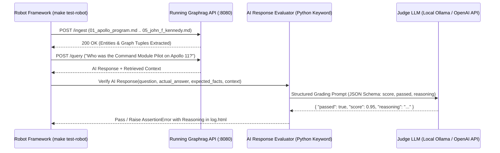

# AI / LLM-as-a-Judge Mechanisms for Robot Framework (`make test-robot`)

**Related PRDs:**
* [Backend Foundations PRD](../prds/backend-foundations-prd.md)
* [Graph RAG PRD](../prds/graph-rag-prd.md)

## Problem Statement
When running `make test-robot` against a live Graphrag instance:
1. Robot Framework loads the baseline `.md` files (`tests/data/graph_rag_baseline/01_apollo_program.md` .. `05_john_f_kennedy.md`) via the Graphrag ingestion API.
2. Robot Framework queries the Graphrag API with natural-language single-hop and multi-hop questions (e.g., *"Which astronaut served as Command Module Pilot on the mission launched by the Saturn V rocket in July 1969, and what goal did that mission fulfill?"*).
3. Because LLM-generated answers are non-deterministic in phrasing, exact substring matching (`Should Contain`) is brittle for phrasing variations while too weak to detect hallucinations or contradictions. We need an automated **AI evaluation mechanism (LLM-as-a-Judge)** integrated cleanly into Robot Framework keywords.



---

## Evaluation of Options

### Option 1: Lightweight Custom Python Keyword Library (`LLMEvalLibrary.py` via OpenAI-compatible HTTP / `pydantic` or `requests`)
Write a small, zero-bloat Python keyword library in `integration-tests/lib/LLMEvalLibrary.py` that calls the same OpenAI-compatible endpoint Graphrag uses (e.g. local Ollama `http://localhost:11434/v1/chat/completions` or OpenAI/Gemini) using structured JSON output (`response_format={"type": "json_schema"}` or JSON mode).

- **How it works in `.robot`:**
  ```robot
  ${answer}=    Query Graphrag    question=Who piloted the Command Module on Apollo 11 and remained in lunar orbit?
  Should Pass AI Evaluation
  ...    question=Who piloted the Command Module on Apollo 11 and remained in lunar orbit?
  ...    actual_answer=${answer}
  ...    expected_ground_truth=Michael Collins was the Command Module Pilot on Apollo 11 and stayed in lunar orbit while Armstrong and Aldrin landed.
  ...    min_score=0.8
  ```
- **Pros:**
  - **Zero heavy dependencies:** Only uses `requests` (already used by Robot API libraries like `AADRequests.py`). Fast `pip install`, no version conflicts with `torch`/`transformers`/`datasets`.
  - **Works offline / with local Ollama:** Can point directly to the local LLM (`LLM_BASE_URL`, `LLM_MODEL`) already running for Graphrag, or to a cloud model.
  - **Deterministic structured rubric:** Returns `{ "passed": bool, "score": float, "missing_facts": [...], "hallucinations": [...], "reasoning": str }` which is logged directly into Robot Framework's `log.html`.
- **Cons:**
  - We maintain the ~80-line grading prompt and JSON schema ourselves (though this also gives us full control over multi-hop graph assertions).

---

### Option 2: `DeepEval` Library Wrapped as a Robot Keyword
[DeepEval](https://github.com/confident-ai/deepeval) provides pre-built LLM-as-a-Judge metrics (`GEval`, `AnswerRelevancyMetric`, `FaithfulnessMetric`, `ContextualRecallMetric`) that can be called inside a custom Python Robot keyword.

- **How it works:**
  Import `LLMTestCase`, `GEval`, and `FaithfulnessMetric` inside `integration-tests/lib/DeepEvalLibrary.py` and call `metric.measure(test_case)`.
- **Pros:**
  - Pre-engineered chain-of-thought prompts for **Faithfulness** (hallucination detection against retrieved graph nodes/chunks), **Answer Relevancy**, and custom **G-Eval** rubrics.
  - Supports local Ollama models (`deepeval set-ollama`) as well as OpenAI/Anthropic.
- **Cons:**
  - Heavy dependency tree (`deepeval` pulls in ~40+ packages including `grpcio`, `opentelemetry`, `pytest`, etc.).
  - Slower evaluation per test case because metrics like `FaithfulnessMetric` make multiple sequential LLM calls (extract claims $\rightarrow$extract truths $\rightarrow$ compare).

---

### Option 3: `Ragas` Wrapped as a Robot Keyword
[Ragas](https://github.com/explodinggradients/ragas) is a dedicated RAG evaluation toolkit measuring `faithfulness`, `answer_relevancy`, `context_precision`, and `context_recall`.

- **Pros:**
  - Specifically designed for RAG pipelines; has a `MultiHopQuery` mindset and strong research backing.
- **Cons:**
  - **Heaviest dependency footprint:** Pulls in HuggingFace `datasets`, `pyarrow`, `langchain`, etc.
  - Designed primarily for batch `Dataset` evaluation rather than fast single-assertion keywords inside Robot Framework.

---

### Option 4: Hybrid Semantic Cosine Similarity + Fact-Checklist Judge
Combine two fast checks inside `integration-tests/lib/GraphRagEval.py`:
1. **Embedding Cosine Similarity:** Compute cosine similarity between the `actual_answer` embedding and `expected_ground_truth` embedding (using the `/v1/embeddings` endpoint already available on the LLM provider).
2. **Structured LLM Fact-Checklist Judge:** Ask the Judge LLM to verify a list of required atomic facts (e.g., `["Michael Collins", "Command Module Pilot", "lunar orbit"]`) and check for contradictions against the source `.md` files.

- **Pros:**
  - Combines fast mathematical similarity with explicit multi-hop fact verification.
  - Still uses only `requests` (zero extra Python dependencies).

---

## Comparison Matrix

| Criteria | Option 1: Custom `LLMEvalLibrary.py` (Structured JSON Judge) | Option 2: `DeepEval` in Robot | Option 3: `Ragas` in Robot | Option 4: Hybrid (Embeddings + Structured Judge) |
|---|---|---|---|---|
| **Python Dependencies** | `requests` only (Minimal) | Heavy (`deepeval` + 40 deps) | `ragas`, `datasets`, `langchain-openai` | `requests` only (Minimal) |
| **Local Ollama Support** | Native (`/v1/chat/completions`) | Supported via adapter | Supported via OpenAI-compatible / Ollama wrapper | Native (`/v1/chat/completions` + `/v1/embeddings`) |
| **Speed per Assertion** | Fast (1 LLM call) | Medium–Slow (2–4 LLM calls) | Medium (SingleTurnSample async evaluation) | Fast (1 embedding call + 1 LLM call) |
| **RAG-Specific Metrics** | Custom prompt | `Faithfulness`, `ContextualRecall` | Purpose-built (`Faithfulness`, `FactualCorrectness`, `ResponseRelevancy`, `LLMContextRecall`) | Custom checklist |
| **Robot `log.html` Clarity** | Full custom JSON breakdown | `metric.score` + `metric.reason` | Metric scores logged per assertion | Cosine score + fact-by-fact pass/fail |

---

## Decision: Ragas Wrapped in a Robot Framework Keyword (`RagasEvalLibrary.py`)

We selected **Ragas** integrated via a custom Robot Framework Python keyword library (`integration-tests/lib/RagasEvalLibrary.py`).

### Ragas Integration Architecture for `make test-robot`
- **Modern Ragas v0.2+ `SingleTurnSample` API:** Instead of constructing full HuggingFace `Dataset` batches for every Robot assertion, Ragas v0.2+ supports `SingleTurnSample(user_input=..., response=..., retrieved_contexts=..., reference=...)` scored directly with metric classes:
  - **`Faithfulness`**: Verifies that the AI response only makes claims grounded in the retrieved Graph RAG context (`retrieved_contexts`).
  - **`FactualCorrectness` / `AnswerCorrectness`**: Compares the AI response (`response`) against the ground-truth reference answer (`reference`) derived from the baseline `.md` files.
  - **`ResponseRelevancy`**: Verifies that the AI response directly addresses the user question (`user_input`).
  - **`LLMContextRecall`**: Verifies that the Graph RAG retrieval step surfaced the necessary facts from the baseline `.md` knowledge graph.
- **LLM & Embedding Configuration:** `RagasEvalLibrary.py` wraps an OpenAI-compatible client (e.g., `LangchainLLMWrapper(ChatOpenAI(base_url=..., api_key=..., model=...))` or native Ragas `llm_factory`) so it works seamlessly against either local Ollama (`http://localhost:11434/v1`) or cloud OpenAI/Gemini endpoints.

