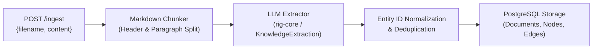

# Spec 07: Graph RAG - Ingestion & LLM Extraction

**Status:** `complete`
**Derived From:** [Graph RAG PRD](../prds/graph-rag-prd.md)

## Objective
Parse raw markdown text into structured graph entities (Knowledge Objects and Graph Tuples) using an LLM and expose an idempotent `POST /ingest` API endpoint.

## Architecture & Flow



## Requirements

### 1. Document Chunking (`src/graph_rag.rs`)
- **Input:** Raw markdown files containing thematic or narrative data.
- **Process:** Split markdown text by markdown headings (`#`, `##`, `###`) and double-newline paragraphs while enforcing a configurable or bounded maximum chunk character length so chunks preserve semantic context.
- **Deterministic IDs:** Compute a deterministic document identifier from the normalized `filename` and chunk index so re-ingestion is idempotent.

### 2. LLM Extraction (`rig-core`)
- **Integration:** Use `rig-core` completion prompting (coupled with a trait abstraction `KnowledgeExtractor` for deterministic unit testing and live LLM execution) to extract structured JSON from each chunk:
  - **Knowledge Objects (Nodes):**
    - `id`: Canonical normalized slug identifier (e.g., `"apollo_11"`, `"michael_collins"`).
    - `label`: Entity category/type (e.g., `"Mission"`, `"Astronaut"`, `"Spacecraft"`).
    - `description`: Coherent textual description synthesized from the chunk.
  - **Graph Tuples (Edges):**
    - `source`: Source node canonical ID.
    - `predicate`: Relationship type (e.g., `"PILOTED"`, `"LANDED_ON"`, `"GRADUATED_FROM"`).
    - `target`: Target node canonical ID.
- **Typed Error Handling:** All extraction and parsing errors must use a dedicated `#[derive(Debug, thiserror::Error)] pub enum GraphRagError` (never `Result<_, String>`).

### 3. HTTP Ingestion Endpoint (`POST /ingest` & `DELETE /documents/{id}`)
- **`POST /ingest` Request Payload:**
  ```json
  {
    "filename": "01_apollo_program.md",
    "content": "# Project Apollo\n..."
  }
  ```
- **`POST /ingest` Response Payload (`200 OK`):**
  ```json
  {
    "document_id": "01_apollo_program.md",
    "chunks_processed": 2,
    "nodes_extracted": 5,
    "edges_extracted": 4
  }
  ```
- **Idempotency:** Re-ingesting the same `filename` updates existing document records, merges/upserts Knowledge Objects by canonical `id`, and upserts Graph Tuples by `(source, predicate, target)`.
- **`DELETE /documents/{id}`:** Deletes the specified document and cleans up associated test artifacts for `[Teardown]` in `make test-robot`.

## Testing Strategy
- **Unit Tests (`src/graph_rag.rs` & `src/routes.rs`):**
  - `test_chunk_markdown_by_headers_and_paragraphs`: Verifies markdown splitting preserves headings and respects max chunk size.
  - `test_parse_llm_extraction_json_and_normalize_ids`: Verifies parsing of LLM JSON output (including markdown code fences) and canonical entity ID normalization/deduplication.
  - `test_ingest_idempotency_merges_nodes_and_edges`: Verifies re-ingesting identical or overlapping chunks merges nodes and edges without duplicating tuples.
- **Integration Tests (`make test-robot`):**
  - Execute `integration-tests/tests/02_graph_rag_baseline.robot` via `make test-robot` to ingest all 5 baseline markdown files via `POST /ingest` and clean them up in `Suite Teardown`.
