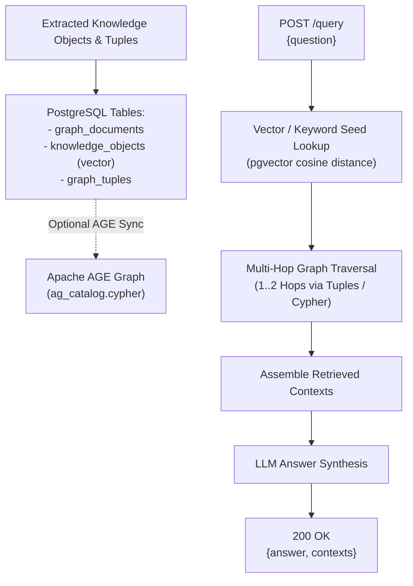

# Spec 08: Graph RAG - Storage & Graph Construction

**Status:** `complete`
**Derived From:** [Graph RAG PRD](../prds/graph-rag-prd.md)

## Objective
Persist extracted entities supporting both semantic similarity search (`pgvector`) and structural multi-hop graph traversal utilizing PostgreSQL and Apache AGE, and expose `POST /query`.

## Architecture & Flow



## Requirements

### 1. Database Schema (`migrations/20261017000000_graph_rag_schema.up.sql`)
- **`graph_documents` table:** Stores ingested markdown files (`id` VARCHAR primary key, `filename`, `content`, `updated_at`).
- **`knowledge_objects` table:** Stores extracted nodes (`id` VARCHAR primary key, `label` VARCHAR, `description` TEXT, `layer` INT DEFAULT 0, `document_id` VARCHAR, `embedding` `vector(64)`).
- **`graph_tuples` table:** Stores directed edges (`source_id` VARCHAR, `predicate` VARCHAR, `target_id` VARCHAR, `document_id` VARCHAR, `PRIMARY KEY (source_id, predicate, target_id)`).
- **Apache AGE Synchronization:** If the `age` extension is installed in the target PostgreSQL instance, synchronize nodes and edges into the AGE graph; always maintain the canonical relational + `pgvector` tables so multi-hop traversal and `pgvector` cosine distance (`<=>`) work seamlessly across all PostgreSQL + `pgvector` environments.

### 2. Vector Embeddings (`pgvector`)
- Generate normalized deterministic or LLM embeddings (`vector(64)`) for every Knowledge Object description and query so `pgvector` cosine similarity (`embedding <=> $1::vector`) retrieves top-K seed nodes.

### 3. Multi-Hop Graph Traversal & `POST /query` Endpoint
- **`POST /query` Request Payload:**
  ```json
  {
    "question": "Who flew the Apollo 11 command module Columbia in lunar orbit?"
  }
  ```
- **Query Execution:**
  1. Compute query embedding and retrieve top seed `knowledge_objects` via `pgvector` cosine similarity and keyword matching.
  2. Traverse 1–2 hops along `graph_tuples` (both outgoing and incoming edges) to collect connected neighbor nodes and relationship predicates.
  3. Include relevant Layer 1+ community summary nodes.
  4. Format the retrieved nodes and relationship triples into `contexts: Vec<String>`.
  5. Prompt the LLM synthesizer with the retrieved `contexts` and `question` to produce `answer`.
- **`POST /query` Response Payload (`200 OK`):**
  ```json
  {
    "answer": "Michael Collins flew the Apollo 11 command module Columbia in lunar orbit...",
    "contexts": [
      "Michael Collins (Astronaut): Command Module Pilot of Apollo 11...",
      "michael_collins -[PILOTED]-> command_module_columbia"
    ]
  }
  ```

## Testing Strategy
- **Unit Tests:**
  - `test_deterministic_embedding_dimension_and_similarity`: Verifies 64-d vector generation and cosine similarity ranking for related terms.
  - `test_multi_hop_subgraph_traversal`: Verifies 2-hop graph expansion from seed nodes across `GraphTuple` edges.
  - `test_query_endpoint_synthesizes_answer_with_contexts`: Verifies `POST /query` returns `200 OK` with `answer` and non-empty `contexts`.
- **Integration Tests (`make test-robot`):**
  - Execute `integration-tests/tests/02_graph_rag_baseline.robot` via `make test-robot` to verify ingestion, multi-hop graph traversal, and Ragas response evaluation.
