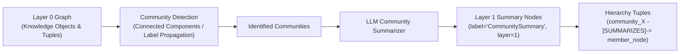

# Spec 09: Graph RAG - Hierarchical Summarization

**Status:** `complete`
**Derived From:** [Graph RAG PRD](../prds/graph-rag-prd.md)

## Objective
Enable the system to answer broad, global queries by clustering Layer 0 Knowledge Objects into communities and generating Layer 1+ Summary Nodes with `pgvector` embeddings.

## Architecture & Flow

## Requirements

### 1. Graph Clustering (Communities)
- Implement deterministic graph community detection (Label Propagation / Connected Community Clustering weighted by shared neighborhoods) over Layer 0 `KnowledgeObject` nodes and `GraphTuple` edges.
- Group interconnected Layer 0 Knowledge Objects into distinct communities with deterministic community identifiers (`community_1`, `community_2`, etc.).

### 2. Hierarchical Summarization
- **Layering System:**
  - **Layer 0:** Base layer of extracted Knowledge Objects (`layer = 0`).
  - **Layer 1:** Community Summary Nodes (`layer = 1`, `label = "CommunitySummary"`).
- **LLM Summarization:**
  - For each community, synthesize a comprehensive summary from its constituent nodes and edges using the `KnowledgeExtractor` / LLM client.
  - Persist each summary as a `KnowledgeObject` with `layer = 1` and its 64-d `pgvector` embedding.
  - Create hierarchical `GraphTuple` edges `(community_id, "SUMMARIZES", member_node_id)` linking each Summary Node to its constituent Layer 0 nodes.

### 3. API & Automatic Summarization
- Automatically update/generate community summaries during ingestion or via `POST /summarize` (`200 OK` returning `{"communities_summarized": N, "summary_nodes": [...]}`) so both local and global queries benefit from Layer 1 summaries.

## Testing Strategy
- **Unit Tests:**
  - `test_detect_communities_clusters_connected_subgraphs`: Verifies that a graph with distinct clusters produces the expected deterministic communities.
  - `test_build_hierarchical_summaries_creates_layer1_nodes_and_edges`: Verifies that community summarization creates `layer = 1` Summary Nodes, generates embeddings, and links them to Layer 0 member nodes with `"SUMMARIZES"` edges.
- **Integration Tests (`make test-robot`):**
  - Execute `make test-robot` against the running Graphrag API to verify community summarization and multi-hop global/local queries.
