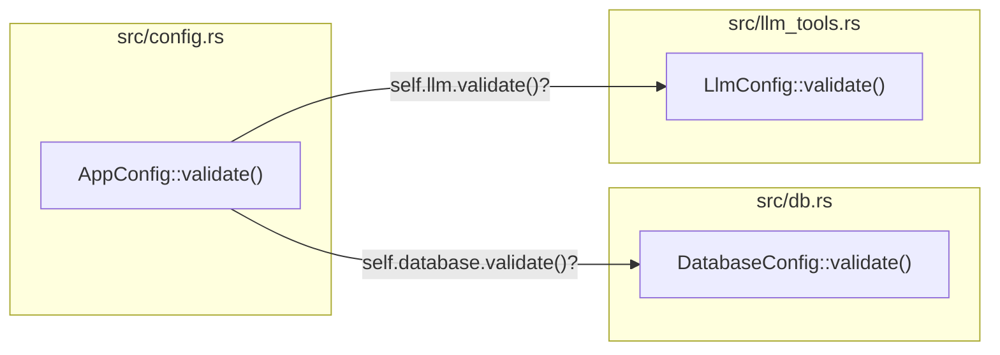

# Spec 11: Modular Configuration Ownership & Delegated Validation

**Status:** `complete`
**Derived From:** [Backend Foundations PRD](../prds/backend-foundations-prd.md)

## Objective
Standardize configuration struct ownership, validation logic, and unit test placement across domain modules (`db`, `llm_tools`, `config`) so that each domain module owns its configuration struct, `.validate()` implementation, and unit tests, while `AppConfig` composes domain configurations and delegates validation.

## Architecture

## Requirements

### 1. LLM Module Ownership (`src/llm_tools.rs`)
- Move `LlmConfig` and `LlmConfig::validate()` from `src/config.rs` into `src/llm_tools.rs`.
- `LlmConfig::validate()` must verify:
  - `provider.trim()` is non-empty (`"llm.provider must not be empty"`).
  - `base_url.trim()` is non-empty (`"llm.base_url must not be empty"`).
  - `model.trim()` is non-empty (`"llm.model must not be empty"`).
  - `timeout_seconds > 0` (`"llm.timeout_seconds must be greater than 0"`).
- `src/llm_tools.rs` `tests` module must contain comprehensive unit tests for `LlmConfig::validate()` (valid config, empty/whitespace `provider`, `base_url`, `model`, and zero `timeout_seconds`).

### 2. Database Module Ownership (`src/db.rs`)
- `DatabaseConfig` and `DatabaseConfig::validate()` reside in `src/db.rs`.
- `src/db.rs` `tests` module must contain direct unit tests for `DatabaseConfig::validate()`:
  - Valid `DatabaseConfig` passes validation.
  - Empty/whitespace `url` returns `Err("database.url must not be empty")`.
  - `pool_size == 0` returns `Err("database.pool_size must be greater than 0")`.
  - `timeout_seconds == 0` returns `Err("database.timeout_seconds must be greater than 0")`.

### 3. Top-Level Composition & Delegation (`src/config.rs`)
- `src/config.rs` imports `DatabaseConfig` from `crate::db::DatabaseConfig` and `LlmConfig` from `crate::llm_tools::LlmConfig` (re-exporting if needed).
- `AppConfig::validate()` delegates to `self.database.validate()?` and `self.llm.validate()?`, and validates top-level fields (`server_port != 0`).
- `src/config.rs` `tests` module tests:
  - YAML and `GRAPHRAG_BE__` environment variable loading & overrides.
  - Top-level validation (`server_port == 0`).
  - Delegation to `database.validate()` and `llm.validate()` (confirming that invalid `database` or `llm` sub-configs fail `AppConfig::validate()` with the delegated error message).

## Testing Strategy
- **Unit Tests:**
  - `cargo test db::tests`: Verify all `DatabaseConfig::validate()` unit cases pass.
  - `cargo test llm_tools::tests`: Verify `LlmClient::new` and all `LlmConfig::validate()` unit cases pass.
  - `cargo test config::tests`: Verify `AppConfig::load`, env overrides, `server_port` check, and delegation to `database.validate()` and `llm.validate()`.
