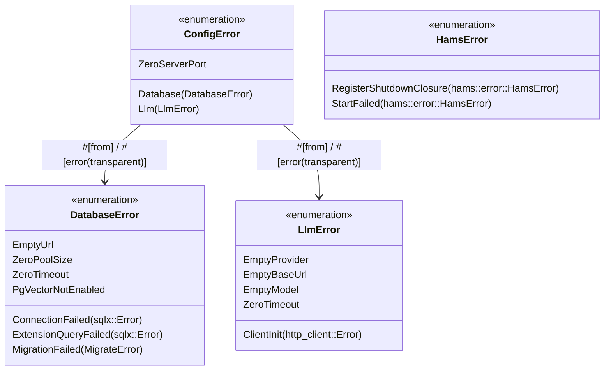

# Spec 12: Typed Error Handling (`thiserror`)

**Status:** `complete`
**Derived From:** [Backend Foundations PRD](../prds/backend-foundations-prd.md)

## Objective
Eliminate all stringly-typed `Result<_, String>` returns across the codebase by introducing domain-specific `thiserror::Error` enums (`ConfigError`, `DatabaseError`, `LlmError`, `HamsError`) with transparent error delegation.

## Architecture

## Requirements

### 1. Database Error Enum (`src/db.rs`)
- Define `DatabaseError` deriving `Debug, thiserror::Error`.
- Update `DatabaseConfig::validate(&self) -> Result<(), DatabaseError>` and `init_db(config: &DatabaseConfig) -> Result<PgPool, DatabaseError>`.

### 2. LLM Error Enum (`src/llm_tools.rs`)
- Define `LlmError` deriving `Debug, thiserror::Error`.
- Wrap `rig_core::http_client::Error` via `#[from]` in `LlmError::ClientInit` rather than converting to `String`.
- Update `LlmConfig::validate(&self) -> Result<(), LlmError>` and `LlmClient::new(config: &LlmConfig) -> Result<Self, LlmError>`.

### 3. HaMS Error Enum (`src/hams_tools.rs`)
- Define `HamsError` deriving `Debug, thiserror::Error` wrapping `hams::error::HamsError` for `RegisterShutdownClosure` and `StartFailed`.
- Update `HamsHarness::init(hams: Hams, ct: CancellationToken) -> Result<Self, HamsError>`.

### 4. Top-Level Config Error Enum (`src/config.rs`)
- Define `ConfigError` deriving `Debug, thiserror::Error` with `ZeroServerPort`, `#[error(transparent)] Database(#[from] DatabaseError)`, and `#[error(transparent)] Llm(#[from] LlmError)`.
- Update `AppConfig::validate(&self) -> Result<(), ConfigError>`.

## Testing Strategy
- **Unit Tests:**
  - Assert that `DatabaseConfig::validate()`, `LlmConfig::validate()`, and `AppConfig::validate()` return the expected typed enum variants (`matches!(result, Err(...))`) as well as expected `.to_string()` messages.
  - Ensure zero occurrences of `Result<_, String>` remain in `src/`.
