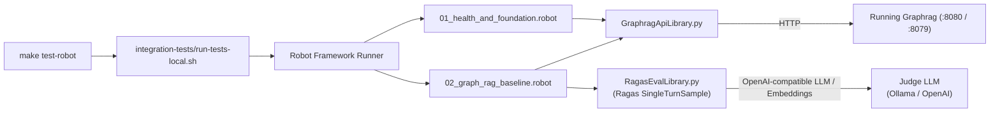

# Spec 14: Robot Framework & Ragas Integration Test Harness (`make test-robot`)

**Status:** `complete`
**Derived From:**
* [Backend Foundations PRD](../prds/backend-foundations-prd.md)
* [Graph RAG PRD](../prds/graph-rag-prd.md)
* [Research: AI / LLM-as-a-Judge Mechanisms for Robot Framework](../research/llm-response-evaluation-for-robot-tests.md)

## Objective
Provide the `make test-robot` integration test harness using Robot Framework and **Ragas** (`RagasEvalLibrary.py`) to test a running Graphrag instance by verifying HaMS probes, loading the baseline `.md` files via the API, querying against them, and grading AI responses with Ragas metrics.

## Architecture

## Requirements

### 1. Makefile Target (`make test-robot`)
- Add `.PHONY: test-robot` and target `test-robot` in `Makefile` that executes `./integration-tests/run-tests-local.sh`.
- Update `Makefile` so developers can run unit tests via `make test` and Robot Framework integration tests against a running Graphrag instance via `make test-robot`.

### 2. Local Test Runner (`integration-tests/run-tests-local.sh`)
- Expects Graphrag to already be running at `LOCAL_BE_URL` (`http://localhost:8080`) and HaMS at `LOCAL_HAMS_BE_URL` (`http://localhost:8079`).
- Performs a pre-flight readiness check against HaMS (`/health/live` and `/health/ready`) and fails fast with a clear message if Graphrag is not running.
- Ensures Python dependencies (`integration-tests/requirements.txt`) are available in a local `.venv` or active Python environment.
- Executes `robot` with variables:
  - `BE_BASE_URL` (default `http://localhost:8080`)
  - `HAMS_BE_URL` (default `http://localhost:8079`)
  - `LLM_BASE_URL` (default `http://localhost:11434/v1`)
  - `LLM_MODEL` (default `llama3`)
  - `BASELINE_DATA_DIR` (default `<repo>/tests/data/graph_rag_baseline`)
- Writes HTML/XML test reports to `integration-tests/reports/`.

### 3. Graphrag API Keyword Library (`integration-tests/lib/GraphragApiLibrary.py`)
- Provides keywords for Robot test suites:
  - `Verify Hams Liveness` / `Verify Hams Readiness` / `Verify Hams Metrics`
  - `Get Hello Endpoint`
  - `Load Markdown File` / `Load Baseline Markdown Directory` (reads `.md` files from `tests/data/graph_rag_baseline/` and posts them to the Graphrag ingestion endpoint)
  - `Ask Graphrag Question` (sends a natural-language question to the Graphrag query endpoint and returns the structured response containing `answer` and `contexts`)
  - `Cleanup Ingested Documents` (invoked in `[Teardown]` to remove test artifacts)

### 4. Ragas AI Evaluation Keyword Library (`integration-tests/lib/RagasEvalLibrary.py`)
- Wraps **Ragas** (`SingleTurnSample` with `Faithfulness`, `FactualCorrectness`, `ResponseRelevancy`, and `LLMContextRecall`) using an OpenAI-compatible LLM and embeddings configuration (`LLM_BASE_URL`, `LLM_API_KEY`, `LLM_MODEL`).
- Exposes Robot Framework keywords:
  - `Evaluate FaithfulnessWith Ragas`
  - `Evaluate Factual Correctness With Ragas`
  - `Evaluate Rag Response With Ragas` (evaluates `question`, `actual_answer`, `retrieved_contexts`, and `reference_answer`, logging scores to `log.html` and failing the test if scores fall below threshold).

### 5. Robot Test Suites (`integration-tests/tests/`)
- `01_health_and_foundation.robot`: Verifies HaMS `/health/live`, `/health/ready`, `/metrics`, and Axum `/hello` against the running service.
- `02_graph_rag_baseline.robot`: Loads `01_apollo_program.md` .. `05_john_f_kennedy.md` into the running Graphrag API, executes single-hop and multi-hop queries across the Apollo 11 knowledge graph, grades the AI answers via `RagasEvalLibrary.py`, and cleans up in `[Teardown]`.

## Testing Strategy
- **Unit Tests:**
  - Python unit tests (`integration-tests/lib/test_libraries.py`) validating `GraphragApiLibrary` request formatting and `RagasEvalLibrary` metric invocation and threshold assertion logic using mocked responses/metrics.
- **Integration Execution:**
  - Verify `make --dry-run test-robot` and runner script pre-flight checks.
