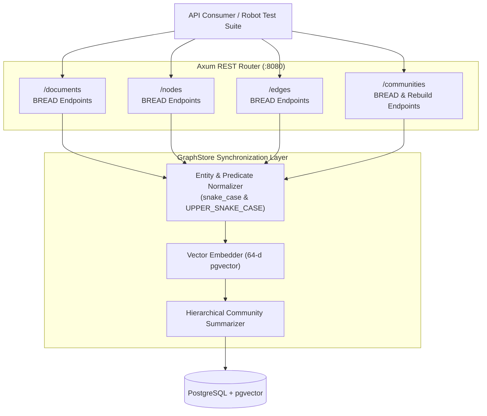

# Spec 16: Graph RAG Data Management (BREAD API)

**Status:** `complete`
**Derived From:**
* [Graph RAG Data Management (BREAD API) PRD](../prds/graph-rag-api-bread-prd.md)
* [Graph RAG PRD](../prds/graph-rag-prd.md)

## Objective
Provide fine-grained Browse, Read, Edit, Add, Delete (BREAD) REST APIs and persistent storage methods for managing `graph_documents`, `knowledge_objects` (nodes), `graph_tuples` (edges), and community summaries without requiring full corpus re-ingestion.

## Architecture

## Requirements & Endpoints

### 1. Documents Resource (`/documents`)
- `GET /documents`: Lists documents with optional `q`, `limit`, `offset`.
- `POST /documents`: Ingests markdown document returning HTTP `201 Created`.
- `GET /documents/{id}`: Returns document metadata, content, and associated extracted nodes and edges.
- `PUT /documents/{id}`: Updates document content, cascades entity cleanups, re-chunks, re-extracts, and updates community summaries.
- `DELETE /documents/{id}`: Deletes document, removes associated nodes/edges where `document_id = id`, and returns `204 No Content`.

### 2. Nodes Resource (`/nodes`)
- `GET /nodes`: Browse nodes with optional `label`, `layer`, `document_id`, `semantic_query`, `limit`, `offset`.
- `POST /nodes`: Creates/upserts a node, normalizes id to `snake_case`, generates 64-d embedding, and updates summaries (`201 Created`).
- `GET /nodes/{id}`: Reads single node along with incoming and outgoing edges (`200 OK`).
- `PUT /nodes/{id}`: Updates node label, description, layer, or document_id, recomputes embedding, and refreshes summaries.
- `DELETE /nodes/{id}`: Deletes node, cascades deletion to all incident edges, and refreshes summaries (`204 No Content`).

### 3. Edges Resource (`/edges`)
- `GET /edges`: Browse edges with optional `source`, `predicate`, `target`, `document_id`, `limit`, `offset`.
- `POST /edges`: Creates directed edge (`201 Created`). Validates source and target exist unless `auto_create_nodes: true`.
- `GET /edges/{source}/{predicate}/{target}`: Reads directed edge with source and target details.
- `PUT /edges/{source}/{predicate}/{target}`: Updates edge predicate, target, or document_id.
- `DELETE /edges/{source}/{predicate}/{target}`: Deletes edge (`204 No Content`).

### 4. Communities Resource (`/communities`)
- `GET /communities`: Browse community summaries with pagination and member search.
- `GET /communities/{id}`: Reads single community summary.
- `PUT /communities/{id}`: Updates community summary description and recomputes embedding.
- `POST /communities/rebuild`: Triggers community re-clustering and summarization.
- `DELETE /communities/{id}`: Deletes community summary node and hierarchy edges.

## Test Strategy
- **Unit Tests**:
  - `src/routes.rs`: Axum test harness verifying status codes (`200`, `201`, `204`, `400`, `404`) and JSON responses across all BREAD endpoints.
- **Integration Tests**:
  - `integration-tests/tests/03_graph_rag_bread_api.robot`: End-to-end BREAD operations and RAG answer validation using `GraphragApiLibrary.py`.
