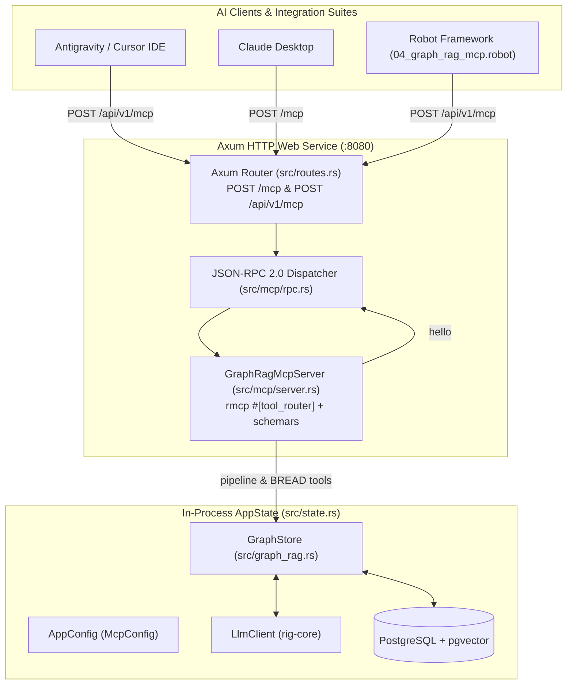
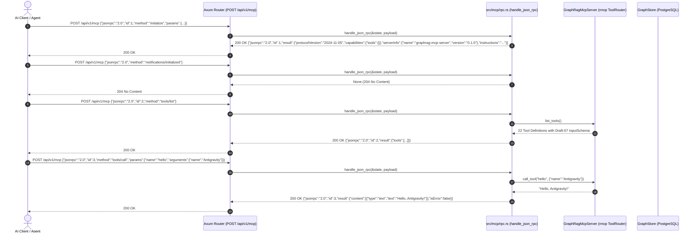

# Spec 17: Graph RAG Model Context Protocol (MCP) Service

**Status:** `complete`
**Derived From:**
* [Graph RAG Model Context Protocol (MCP) PRD](../prds/graph-rag-mcp-prd.md)
* [Graph RAG Data Management (BREAD API) PRD](../prds/graph-rag-api-bread-prd.md)
* [Graph RAG PRD](../prds/graph-rag-prd.md)

## Objective
Provide an in-process Model Context Protocol (MCP) service over standard HTTP JSON-RPC 2.0 transport (`/mcp` and `/api/v1/mcp`) on the primary Axum web server (`:8080`), following the architecture patterns established in `aad-mcp-container`. The MCP service allows AI clients (Antigravity, Cursor, Claude Desktop, and autonomous agents) to discover and invoke tools for system health/smoke-testing (`hello`), end-to-end Graph RAG execution (`graphrag_ingest`, `graphrag_query`), and full BREAD operations across Documents, Nodes, Edges, and Communities.

---

## Architecture & Lifecycle



### Protocol Sequence Flow



---

## Detailed Requirements & Contracts

### 1. Dependencies (`Cargo.toml`)
- `rmcp = { version = "3.2.0", features = ["server", "macros", "schemars"] }`
- `schemars = "0.8"`

### 2. Configuration & Validation (`McpConfig`)
`McpConfig` in `src/mcp/mod.rs` (composed into `AppConfig` in `src/config.rs`):
```rust
#[derive(Debug, Clone, Serialize, Deserialize, PartialEq, Eq)]
pub struct McpConfig {
    pub enabled: bool,
    pub api_prefix: String,
    pub server_name: String,
    pub instructions: String,
}
```
Validation rules:
- `api_prefix` must start with `/` and not end with `/` (e.g. `/api`). If invalid, fail with `McpError::InvalidApiPrefix`.
- `server_name` must not be empty or whitespace-only. If empty, fail with `McpError::EmptyServerName`.
- `instructions` must not be empty or whitespace-only. If empty, fail with `McpError::EmptyInstructions`.

Delegated via `AppConfig::validate(&self) -> Result<(), ConfigError>`.
Default configuration in `config.yaml`:
```yaml
mcp:
  enabled: true
  api_prefix: "/api"
  server_name: "graphrag-mcp-server"
  instructions: "GraphRAG-RS Model Context Protocol service providing baseline verification, Graph RAG ingestion and retrieval, and full BREAD operations."
```

### 3. Error Handling (`McpError`)
In `src/mcp/mod.rs`:
```rust
#[derive(thiserror::Error, Debug)]
pub enum McpError {
    #[error("Invalid MCP api_prefix '{0}': must start with '/' and not end with '/'")]
    InvalidApiPrefix(String),
    #[error("MCP server_name cannot be empty")]
    EmptyServerName,
    #[error("MCP instructions cannot be empty")]
    EmptyInstructions,
    #[error("Tool not found: '{0}'")]
    ToolNotFound(String),
    #[error("Invalid arguments for tool '{0}': {1}")]
    InvalidArguments(String, String),
    #[error("Greeting name cannot be empty")]
    EmptyGreetingName,
    #[error("Graph RAG error: {0}")]
    GraphRag(#[from] crate::graph_rag::GraphRagError),
    #[error("JSON serialization error: {0}")]
    Serialization(#[from] serde_json::Error),
}
```

### 4. JSON-RPC 2.0 Dispatcher (`src/mcp/rpc.rs`)
- Endpoint accepts `POST /mcp` and `POST /api/v1/mcp` (using `mcp.api_prefix`).
- Methods supported:
  - `initialize`: returns server info, protocol version `"2024-11-05"`, capabilities (`{"tools": {}}`), instructions.
  - `notifications/initialized`: returns HTTP 204 No Content (or empty result if id present).
  - `ping`: returns `{}` result.
  - `tools/list`: returns array of 22 tools with generated JSON Schema.
  - `tools/call`: executes named tool and returns `{ "content": [{"type": "text", "text": "..."}], "isError": bool }`.
- Error codes conform to JSON-RPC 2.0:
  - `-32600`: Invalid Request (missing method or invalid JSON-RPC envelope).
  - `-32601`: Method Not Found.
  - `-32602`: Invalid Params (missing tool name or invalid arguments).

### 5. Tool Definitions (`GraphRagMcpServer`)
Total 22 tools implemented with `rmcp` macros:
1. **Baseline**: `hello` (rejects empty/whitespace-only input with `isError: true`).
2. **Pipeline**: `graphrag_ingest`, `graphrag_query`.
3. **Documents BREAD**: `document_browse`, `document_read`, `document_edit`, `document_add`, `document_delete`.
4. **Nodes BREAD**: `node_browse`, `node_read`, `node_edit`, `node_add`, `node_delete`.
5. **Edges BREAD**: `edge_browse`, `edge_read`, `edge_edit`, `edge_add`, `edge_delete`.
6. **Communities BREAD & Rebuild**: `community_browse`, `community_read`, `community_edit`, `community_rebuild`, `community_delete`.

---

## Test Strategy

### Unit Tests
- `src/mcp/mod.rs`: `McpConfig::validate()` testing valid configs and each failure variant (`InvalidApiPrefix`, `EmptyServerName`, `EmptyInstructions`).
- `src/mcp/rpc.rs`: JSON-RPC 2.0 protocol dispatch unit tests:
  - `initialize` payload and protocol version.
  - `notifications/initialized` returns `None` (204).
  - `ping` response.
  - `tools/list` returns 22 tools.
  - `tools/call` for `hello` success and empty error cases.
  - JSON-RPC error responses (`-32600`, `-32601`, `-32602`).
- `src/routes.rs`: Axum integration tests for `POST /mcp` and `POST /api/v1/mcp`.

### Robot Framework Integration Tests
- Suite: `integration-tests/tests/04_graph_rag_mcp.robot`.
- Python Library: `integration-tests/lib/GraphragApiLibrary.py` extended with MCP keywords:
  - `Send Mcp Request`: POST to `/api/v1/mcp` or `/mcp`.
  - `Call Mcp Tool`: Dispatches `tools/call` and returns structured result.
- Integration Journey:
  1. MCP Handshake (`initialize` + `notifications/initialized`).
  2. Tools Discovery (`tools/list` returns all 22 tools).
  3. Baseline Verification (`hello` with valid name, and error with empty name).
  4. Documents BREAD via MCP (`document_add`, `document_browse`, `document_read`, `document_delete`).
  5. Nodes & Edges BREAD via MCP (`node_add`, `node_read`, `edge_add`, `edge_read`).
  6. Pipeline Execution (`graphrag_ingest` and `graphrag_query`).
