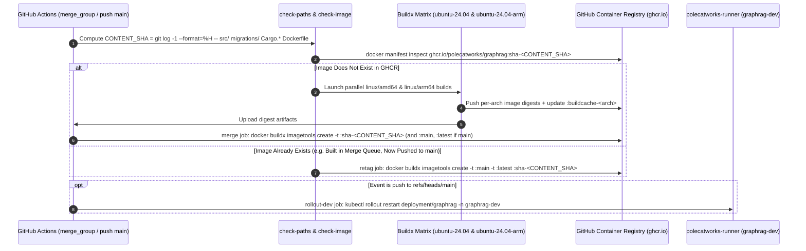
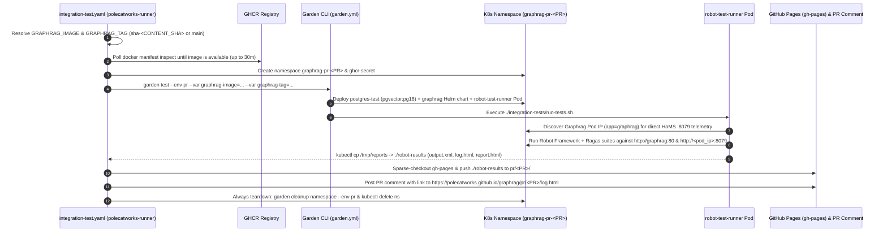

# Specification 18: CI/CD Container Integration

**Status:** complete

## Overview
This specification details the CI/CD pipeline, multi-architecture Docker build, Helm chart configuration, and ephemeral Kubernetes integration testing environment for the Graph RAG project, as defined in `spec/prds/ci-cd-container-integration-prd.md`.

## Diagrams

### Docker Build & Publish Workflow

### Ephemeral Kubernetes Integration Testing

## Requirements

### 1. Multi-Stage `Dockerfile`
- Base build image: `lukemathwalker/cargo-chef:latest-rust-1-bookworm`
- Stages: `chef`, `planner`, `buildcache`, `dev`, `buildcacherelease`, `build`
- Runtime image: `debian:bookworm-slim`
- Installed runtime dependencies: `libssl3`, `ca-certificates`
- Copies `/app/target/release/app` to `/usr/local/bin/app`
- Exposes ports `8080` and `8079`
- `ENTRYPOINT ["/usr/local/bin/app"]` and `CMD ["-c", "/app/config.yaml"]`

### 2. Helm Chart (`charts/graphrag`)
- `Chart.yaml`: `name: graphrag`, version `0.1.0`
- `values.yaml`: Image `ghcr.io/polecatworks/graphrag:latest`, ports `8080`/`8079`
- `deployment.yaml`: Defines container deployment, configuring HaMS liveness (`/health/alive`) and readiness (`/health/ready`) probes on port `8079`.

### 3. GitHub Actions Workflows
- `.github/workflows/ci.yml`: Runs on PR. Triggers backend and Helm jobs based on paths.
- `.github/workflows/skip-merge-queue.yml`: Emits fast-passing status checks on `merge_group`.
- `.github/workflows/docker-publish.yml`: Multi-arch matrix build using buildx caching, merges and pushes digest tagged by content SHA, retags on push to main, restarts K8s rollout.
- `.github/workflows/helm-ci-pr.yaml` and `helm-ci-main.yaml`: Helm chart linting and publishing to OCI registry.
- `.github/workflows/cleanup-dev-packages.yml`: Cleans up ghcr.io images.
- `.github/workflows/integration-test.yaml`: Sets up ephemeral test namespace, resolves image, runs tests with garden, publishes reports to `gh-pages` and comments on PR.

### 4. Garden Configuration
- `garden.yml`: Defines environments `local` and `pr`, deploys `postgres-test` and `graphrag` helm chart.
- `integration-tests/garden.yml`: Defines `robot-test-runner` pod and `integration-all` test action.
- `integration-tests/run-tests.sh`: Helper script to discover pod IPs and execute test runner inside the runner pod.
