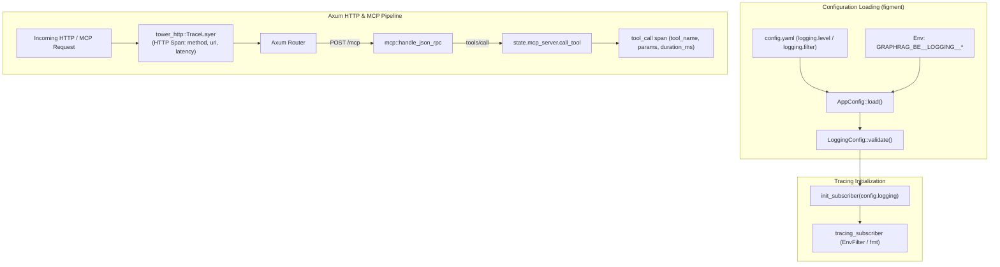

# Spec 19: API & MCP Tracing, Observability & Configurable Logging

## Status
`complete`

## Type
Implementation

## Context & Relationships
* **Parent PRDs**:
  * [Graph RAG MCP Service PRD](../prds/graph-rag-mcp-prd.md)
  * [Backend Foundations PRD](../prds/backend-foundations-prd.md)
* **Related Specs**:
  * [Spec 02: Config Loader Spec](./02-config-loader-spec.md)
  * [Spec 11: Modular Config Validation Spec](./11-modular-config-validation-spec.md)
  * [Spec 12: Typed Error Handling Spec](./12-typed-error-handling-spec.md)
  * [Spec 16: Graph RAG BREAD API Spec](./16-graph-rag-bread-api-spec.md)
  * [Spec 17: Graph RAG MCP Service Spec](./17-graph-rag-mcp-service-spec.md)

---

## 1. Overview & Objectives

This specification defines the observability, structured tracing, and centralized logging architecture for **GraphRAG-RS**.

Key objectives:
1. **Centralized `LoggingConfig` with Fail-Fast Validation**:
   - Define a strongly typed `LoggingConfig` (`level`, `filter`) owned in a dedicated module (`src/logging.rs` or `src/config.rs`) and composed into `AppConfig`.
   - Validate allowed log levels (`trace`, `debug`, `info`, `warn`, `error`) and filter directives fail-fast at startup.
   - Support declarative environment variable overrides using the standard prefix: `GRAPHRAG_BE__LOGGING__LEVEL` and `GRAPHRAG_BE__LOGGING__FILTER`. Zero runtime `std::env::var` calls in business logic.
2. **HTTP API Request/Response Tracing**:
   - Apply `tower_http::trace::TraceLayer` to Axum routes (`/api/v1/*` and `/mcp`).
   - Emit structured request spans (`method`, `uri`, `status`, `latency_ms`).
3. **MCP JSON-RPC Tracing & Diagnostics**:
   - Instrument `handle_json_rpc` with `#[tracing::instrument]`.
   - Trace JSON-RPC methods (`initialize`, `tools/list`, `tools/call`, `ping`).
   - For `tools/call`, emit explicit `DEBUG` / `TRACE` events capturing `tool_name`, input parameters, execution latency, and success/error status.
4. **Developer Watch Mode Integration**:
   - Update `Makefile` targets (`gr-be-watch`) to pass `GRAPHRAG_BE__LOGGING__LEVEL=debug` or `GRAPHRAG_BE__LOGGING__FILTER="debug,app=debug,tower_http=debug"` so watch mode immediately outputs granular execution traces without requiring manual configuration file edits.

---

## 2. Architecture & Data Flow



---

## 3. Configuration & Error Types

### 3.1 `LoggingConfig`
```rust
#[derive(Debug, Clone, Deserialize, Serialize, PartialEq, Eq)]
pub struct LoggingConfig {
    #[serde(default = "default_log_level")]
    pub level: String,
    pub filter: Option<String>,
}

fn default_log_level() -> String {
    "info".to_string()
}
```

Validation rules:
- `level` must be one of: `"trace"`, `"debug"`, `"info"`, `"warn"`, `"error"` (case-insensitive).
- If `filter` is provided, it must not be empty or whitespace-only.

### 3.2 `LoggingError`
```rust
#[derive(Debug, thiserror::Error, PartialEq, Eq)]
pub enum LoggingError {
    #[error("Invalid log level '{0}': must be one of trace, debug, info, warn, error")]
    InvalidLogLevel(String),
    #[error("Log filter cannot be empty if specified")]
    EmptyFilter,
}
```

Composed into `ConfigError`:
```rust
#[derive(Debug, thiserror::Error)]
pub enum ConfigError {
    ...
    #[error(transparent)]
    Logging(#[from] LoggingError),
}
```

---

## 4. Test Strategy (TDD)

### Unit Tests
1. **Config Validation**:
   - Valid levels (`"info"`, `"debug"`, `"trace"`, `"WARN"`, `"ERROR"`).
   - Invalid levels (`"verbose"`, `""`, `"none"`) fail with `LoggingError::InvalidLogLevel`.
   - Empty/whitespace filter fails with `LoggingError::EmptyFilter`.
2. **Environment Variable Overrides**:
   - Verify `GRAPHRAG_BE__LOGGING__LEVEL=debug` overrides yaml defaults via `AppConfig::load`.
3. **Tracing Initialization**:
   - Verify subscriber initializes correctly from `LoggingConfig`.
4. **MCP RPC Tracing**:
   - Verify `tools/call` executes under instrumented spans and records tool execution details.

### Integration Tests
- Verify `make gr-be-test` clean pass across all 65+ tests.
- Manual / log verification via `cargo run` with `GRAPHRAG_BE__LOGGING__LEVEL=debug`.
