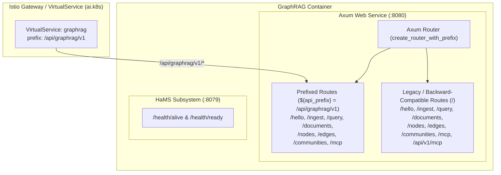

# Spec 20: Configurable API Prefix & Istio VirtualService Composition

- **Status**: `complete`
- **Phase**: Phase 20 (Configurable API Prefix & Istio VirtualService Composition)
- **Primary PRD References**:
  - [Backend Foundations PRD](../prds/backend-foundations-prd.md)
  - [GitHub CI, Multi-Arch Docker Publish & Ephemeral Integration Testing PRD](../prds/ci-cd-container-integration-prd.md)
  - [Graph RAG Data Management (BREAD API) PRD](../prds/graph-rag-api-bread-prd.md)
  - [Graph RAG Model Context Protocol (MCP) PRD](../prds/graph-rag-mcp-prd.md)
- **Dependencies**:
  - [04-axum-service-spec.md](./04-axum-service-spec.md)
  - [11-modular-config-validation-spec.md](./11-modular-config-validation-spec.md)
  - [12-typed-error-handling-spec.md](./12-typed-error-handling-spec.md)
  - [16-graph-rag-bread-api-spec.md](./16-graph-rag-bread-api-spec.md)
  - [17-graph-rag-mcp-service-spec.md](./17-graph-rag-mcp-service-spec.md)
  - [18-ci-cd-container-integration-spec.md](./18-ci-cd-container-integration-spec.md)

---

## 1. Objective & Architectural Context

To support unified multi-service Kubernetes cluster routing under Istio without complex URI path rewrite rules, GraphRAG-RS endpoints must be accessible under a configurable `api_prefix` (defaulting to `"/api/graphrag/v1"`).

1. **Zero-Rewrite Istio Ingress**:
   - The Istio ingress gateway routes `/api/graphrag/v1/*` directly to the `graphrag` Kubernetes Service without stripping or rewriting path prefixes.
   - The Helm chart provides an optional Istio `VirtualService` resource configured to route requests matching the prefix `{{ .Values.virtualService.apiPrefix }}` directly to the backend service.
2. **Backward-Compatible Dual Routing**:
   - Core pipeline routes (`/hello`, `/ingest`, `/query`), BREAD routes (`/documents`, `/nodes`, `/edges`, `/communities`), and MCP routes (`/mcp`) are served under `${api_prefix}` (e.g. `/api/graphrag/v1/hello`, `/api/graphrag/v1/ingest`, `/api/graphrag/v1/mcp`).
   - For backward compatibility with existing tests, local dev scripts, and legacy callers, the same routes are simultaneously exposed at root (`/hello`, `/ingest`, `/query`, `/documents`, `/nodes`, `/edges`, `/communities`, `/mcp`, `/api/v1/mcp`).
3. **HaMS Sidecar Isolation**:
   - The HaMS health and metrics subsystem continues to run on port `8079` (`/health/alive`, `/health/ready`, `/metrics`) unaffected by `api_prefix`.



---

## 2. Technical Specifications

### 2.1 Configuration Layer (`graphrag-container/src/config.rs`)

1. **`AppConfig` Schema**:
   - Add field `pub api_prefix: String` with `#[serde(default = "default_api_prefix")]`.
   - Helper function `fn default_api_prefix() -> String` returning `"/api/graphrag/v1".to_string()`.
2. **Validation Rules**:
   - Add `InvalidApiPrefix(String)` to `ConfigError`.
   - `api_prefix` must start with `'/'` and must not end with `'/'` (when length > 1).
   - If invalid, `validate()` returns `Err(ConfigError::InvalidApiPrefix(self.api_prefix.clone()))`.
3. **Environment Variable Override**:
   - Supported via `GRAPHRAG_BE__API_PREFIX` (handled automatically by `figment::providers::Env::prefixed("GRAPHRAG_BE__")`).
4. **Unit Tests**:
   - Verify default `api_prefix` is `"/api/graphrag/v1"`.
   - Verify YAML loading and env var overrides for `api_prefix`.
   - Verify validation fails if `api_prefix` does not start with `'/'` or ends with `'/'`.

### 2.2 Routing Layer (`graphrag-container/src/routes.rs` & `src/main.rs`)

1. **Core Sub-Router**:
   - Define internal helper `core_routes() -> Router<AppState>` containing:
     - `/hello` (`get(hello)`)
     - `/ingest` (`post(ingest_document)`)
     - `/query` (`post(query_graphrag)`)
     - `/documents` (`get(browse_documents).post(add_document)`)
     - `/documents/{id}` (`get(read_document).put(edit_document).delete(delete_document)`)
     - `/nodes` (`get(browse_nodes).post(add_node)`)
     - `/nodes/{id}` (`get(read_node).put(edit_node).delete(delete_node)`)
     - `/edges` (`get(browse_edges).post(add_edge)`)
     - `/edges/{source}/{predicate}/{target}` (`get(read_edge).put(edit_edge).delete(delete_edge)`)
     - `/communities` (`get(browse_communities)`)
     - `/communities/rebuild` (`post(rebuild_communities)`)
     - `/communities/{id}` (`get(read_community).put(edit_community).delete(delete_community)`)
     - `/mcp` (`post(handle_http_mcp)`)
2. **Prefixed and Root Composition**:
   - Function `create_router_with_prefix(api_prefix: &str) -> Router<AppState>`:
     - Normalizes prefix: strips trailing slash, defaults to `"/api/graphrag/v1"` if empty.
     - Creates `prefixed = Router::new().nest(prefix, core_routes())`.
     - Mounts `core_routes()` at root `/` via `.merge(core_routes())`.
     - Mounts `/api/v1/mcp` (`post(handle_http_mcp)`) for legacy MCP compatibility.
     - Applies `TraceLayer::new_for_http()`.
   - Function `create_router() -> Router<AppState>` calls `create_router_with_prefix("/api/graphrag/v1")`.
3. **Application Entrypoint (`src/main.rs`)**:
   - Uses `routes::create_router_with_prefix(&config.api_prefix).with_state(app_state)`.

### 2.3 Helm Chart & Values (`charts/graphrag`)

1. **`charts/graphrag/configs/config.yaml`**:
   - Add `api_prefix: "/api/graphrag/v1"`.
2. **`charts/graphrag/values.yaml`**:
   - Add `virtualService` block:
     ```yaml
     virtualService:
       enabled: false
       hosts:
         - ai.k8s
       gateways:
         - istio-ingress/k8s-gateway
         - mesh
       apiPrefix: /api/graphrag/v1
     ```
3. **`charts/graphrag/templates/virtualservice.yaml`**:
   - Render Istio `VirtualService` (`apiVersion: networking.istio.io/v1beta1`) when `.Values.virtualService.enabled` is `true`.
   - Matches `uri.prefix: {{ .Values.virtualService.apiPrefix }}` routing to destination host `{{ include "graphrag.fullname" . }}` and port `{{ .Values.service.port }}` without URI rewrites.

---

## 3. Test Strategy & Verification Plan

1. **Config Unit Tests (`src/config.rs`)**:
   - Test default `api_prefix`.
   - Test custom `api_prefix` loaded from YAML and Environment variables.
   - Test invalid `api_prefix` validation errors:
     - Missing leading slash (`"api/graphrag/v1"`).
     - Trailing slash (`"/api/graphrag/v1/"`).
2. **Routes Unit / Integration Tests (`src/routes.rs`)**:
   - Test GET `/api/graphrag/v1/hello` returns `200 OK` ("Hello, World!").
   - Test GET `/hello` returns `200 OK` (backward compatibility).
   - Test POST `/api/graphrag/v1/mcp` and POST `/api/v1/mcp` return valid response (e.g. 200 OK for ping or 204 for notifications).
   - Test custom prefix `create_router_with_prefix("/api/custom/v2")` responds on `/api/custom/v2/hello`.
3. **Helm Lint Verification**:
   - Run `helm lint charts/graphrag`.
   - Test template rendering with `--set virtualService.enabled=true`.
