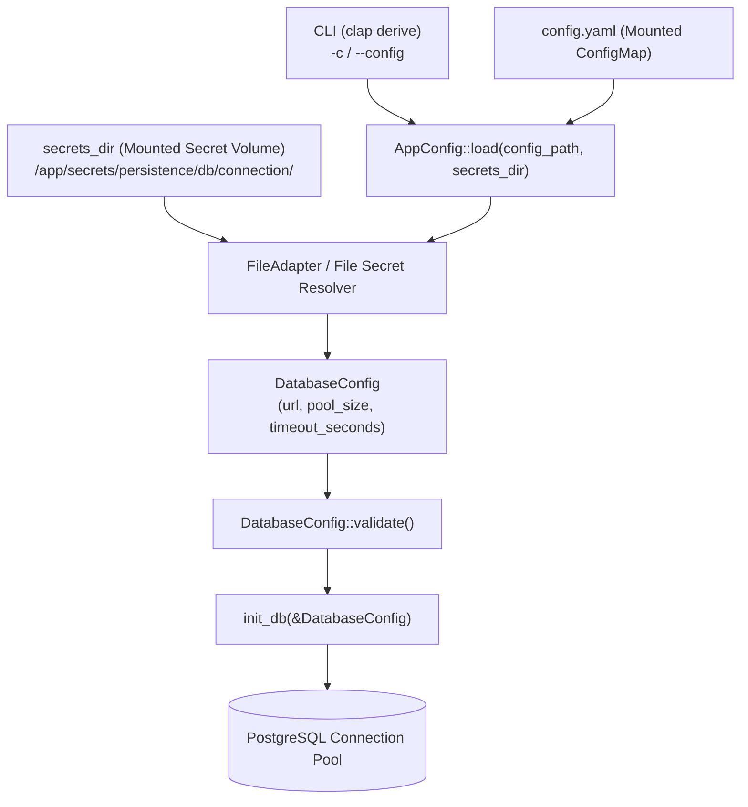

# Specification 21: File-Based Database Secrets & Config Resolution

## 1. Overview & Operational Outcomes
This specification implements file-based secret resolution for the Graphrag service configuration, mirroring the established pattern in `agent-as-data-be`.

It allows Kubernetes Helm releases to configure database connectivity directly under `values.config` using structured connection objects referencing volume-mounted secret files (e.g. from Projected Secrets or Secret volumes), eliminating the need for environment variable password interpolation or raw plaintext passwords in Git.

### Operational Outcomes:
1. **Backward Compatible String URLs**: If `database.url` is supplied as a plain string (e.g. `"postgres://localhost:5432/graphrag"`), it continues to deserialize and function as before.
2. **Structured File-Based Secret Resolution**: If `database.url` is supplied as a structured map:
   ```yaml
   database:
     url:
       url: "postgres://cnpg-db0-cluster-rw.dbs.svc.cluster.local:5432/graphrag"
       username_file: "persistence/db/connection/username"
       password_file: "persistence/db/connection/password"
   ```
   the application resolves `username_file` and `password_file` relative to the configured `secrets_dir` and constructs the target connection URL with credentials.
3. **CLI Arguments (`clap` Derive)**: `src/cli.rs` adds optional `--secrets-dir` (`-s`) defaulting to `"config"` (or `"."`), preserving `--config` (`-c`).
4. **Zero Plaintext Credentials in Git/ConfigMaps**: Helm charts can mount `db0-agent-as-data-user` into `/app/secrets` and configure the database purely through `values.config`.

---

## 2. Architecture & Data Flow



---

## 3. Payload Contracts & Struct Definitions

### Database Configuration
```rust
#[derive(Debug, Clone, PartialEq)]
pub struct DatabaseUrlConfig {
    pub url: String,
    pub username: Option<String>,
    pub password: Option<String>,
}

#[derive(Debug, Deserialize)]
#[serde(untagged)]
enum DatabaseUrlHelper {
    Structured {
        url: String,
        username_file: Option<String>,
        password_file: Option<String>,
        username: Option<String>,
        password: Option<String>,
    },
    Simple(String),
}
```

When converted to an active connection string via `connection_url(&self) -> Result<String, DatabaseError>`, it injects resolved username and password into the target URI.

---

## 4. Test Strategy (Strict TDD)

### Unit Tests (`graphrag-container/src/db.rs` & `graphrag-container/src/config.rs`)
1. **Simple URL Deserialization**: Deserializes a string URL and produces identical results as previous versions.
2. **Structured URL with Inlined Credentials**: Validates deserialization when username/password are already populated.
3. **Structured URL with File References**: Creates temporary secret files (`username_file`, `password_file`), parses structured YAML with `secrets_dir`, and verifies that credentials are read and URL is correctly assembled.
4. **Missing Secret File Validation**: Verifies fail-fast error reporting if `username_file` or `password_file` is specified but missing on disk.
5. **CLI Parsing**: Verifies `-s` / `--secrets-dir` flag in `Cli::parse`.

### Integration Tests
- Validates `make test` runs cleanly.
- Updates `fluxcd-dev/graphrag.yaml` to mount secret volume and configure `values.config.database.url` with `username_file` / `password_file`.
