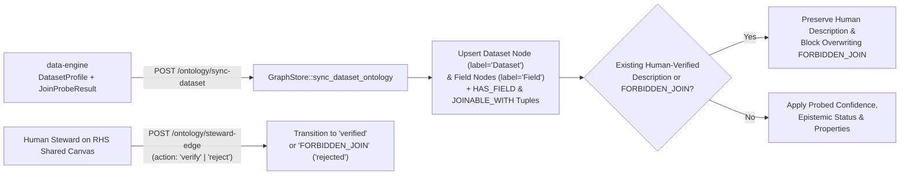

# Spec 22: Autonomous Ontology Schema, Epistemic Lifecycle & Dataset Sync (`POST /ontology/sync-dataset`)

- **Status**: `complete`
- **Derived From**: [autonomous-semantic-ontology-prd.md](../prds/autonomous-semantic-ontology-prd.md)

## 1. Objective
Extend **GraphRAG-RS** (`knowledge_objects` and `graph_tuples`) with epistemic lifecycle metadata (`epistemic_status`, `confidence`, `verified_by`, `properties: JSONB`) and implement idempotent dataset/join-probe ontology synchronization (`POST /ontology/sync-dataset` and MCP tool `ontology_sync_dataset`) plus human steward verification/rejection (`POST /ontology/steward-edge` and MCP tool `ontology_steward_edge`).

## 2. Ontology Sync & Steward Lifecycle Flow



## 3. Schema Migration & Payload Contracts

### 3.1 Database Migration (`20261117000000_autonomous_ontology_metadata.up.sql` & `.down.sql`)
Adds to `knowledge_objects` and `graph_tuples`:
- `epistemic_status VARCHAR(64) NOT NULL DEFAULT 'verified'`
- `confidence FLOAT8 NOT NULL DEFAULT 1.0`
- `verified_by VARCHAR(255)`
- `properties JSONB NOT NULL DEFAULT '{}'::jsonb`

### 3.2 `POST /ontology/sync-dataset` (`OntologySyncDatasetRequest`)
```json
{
  "dataset_name": "sales_orders",
  "description": "Customer sales orders table",
  "row_count": 200,
  "schema_fingerprint_sha256": "a9c1...",
  "epistemic_status": "discovered",
  "fields": [
    {
      "field_name": "cust_ref_key",
      "arrow_data_type": "Utf8",
      "description": "Foreign key to CRM customer party UUID",
      "null_ratio": 0.0,
      "uniqueness_ratio": 0.5,
      "inferred_semantic_domain": "identifier",
      "epistemic_status": "discovered"
    }
  ],
  "join_edges": [
    {
      "left_dataset": "sales_orders",
      "left_field": "cust_ref_key",
      "right_dataset": "crm_customers",
      "right_field": "party_uuid",
      "observed_cardinality": "N:1",
      "inclusion_ratio": 0.985,
      "row_multiplication_factor": 1.0,
      "fan_out_risk": false,
      "homonym_trap_warning": false,
      "confidence": 0.98,
      "epistemic_status": "empirically_tested"
    }
  ]
}
```

### 3.3 `POST /ontology/steward-edge` (`StewardEdgeRequest`)
Allows a human steward (or automated `BIRD-SQL` `evidence` oracle) to either certify (`action = "verify"`) or reject (`action = "reject"`) a proposed join relationship:
- When `action == "reject"`, converts the relationship into a `FORBIDDEN_JOIN` edge with `epistemic_status = "rejected"`, `verified_by`, and `properties.rejection_reason`.
- Subsequent calls to `sync_dataset_ontology` **never overwrite** an existing `FORBIDDEN_JOIN` between those two fields.

## 4. Test Strategy (TDD)
1. `test_sync_dataset_creates_dataset_fields_and_join_edges`: Syncs `crm_customers` and `sales_orders` (`TRAP-02`), verifying `Dataset` nodes, `Field` nodes (`sales_orders_cust_ref_key`, `crm_customers_party_uuid`), `HAS_FIELD` edges, and `JOINABLE_WITH` edges with `confidence` and `properties`.
2. `test_steward_reject_converts_to_forbidden_join_and_prevents_overwrite`: Rejects `billing_subscriptions.account_id` $\leftrightarrow$ `marketing_leads.account_id` (`TRAP-01`), verifies `FORBIDDEN_JOIN` is stored with `verified_by` and `rejection_reason`, and confirms re-running `sync_dataset_ontology` does not re-enable `JOINABLE_WITH`.
