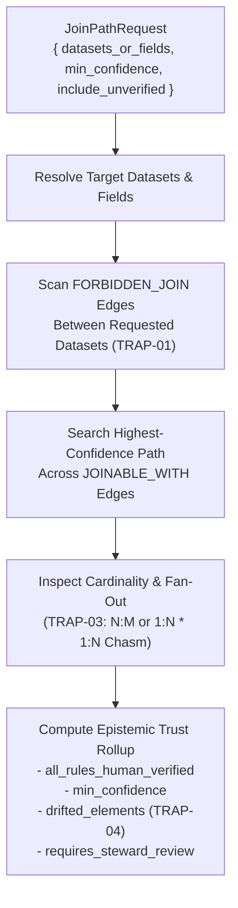

# Spec 23: Multi-Hop Steiner Join-Path Planner, `FORBIDDEN_JOIN` Blocking & Fan-Out Detector (`POST /ontology/join-path`)

- **Status**: `complete`
- **Derived From**: [autonomous-semantic-ontology-prd.md](../prds/autonomous-semantic-ontology-prd.md)

## 1. Objective
Implement the multi-hop ontology join-path planner (`POST /ontology/join-path` and MCP tool `graphrag_find_join_path`). Given target datasets, fields, or business concepts, the planner:
1. Resolves seed concepts/fields/datasets to canonical `Dataset` and `Field` nodes.
2. Searches `JOINABLE_WITH` edges for the highest-confidence connecting join path while **strictly blocking** any path that crosses a `FORBIDDEN_JOIN` edge (recording blocked attempts in `blocked_forbidden_joins`).
3. Inspects `observed_cardinality` (`1:1`, `1:N`, `N:1`, `N:M`) and `fan_out_risk` along the path and emits structured `fan_out_warnings` whenever an `N:M` edge or a $1:N \times 1:N$ chasm trap is traversed (`TRAP-03`).
4. Computes an **Epistemic Trust Rollup** (`all_rules_human_verified`, `min_confidence`, `requires_steward_review`, `unverified_elements`, `drifted_elements`) so `agent-as-data` and `Angry-agent` know whether to execute immediately or surface the RHS Shared Canvas for human review.

## 2. Planner Execution Flow



## 3. Payload Contract (`JoinPathResponse`)
```json
{
  "resolved_datasets": ["sales_orders", "crm_customers"],
  "join_steps": [
    {
      "left_dataset": "sales_orders",
      "left_field": "sales_orders_cust_ref_key",
      "right_dataset": "crm_customers",
      "right_field": "crm_customers_party_uuid",
      "cardinality": "N:1",
      "confidence": 0.98,
      "epistemic_status": "empirically_tested",
      "verified_by": null
    }
  ],
  "blocked_forbidden_joins": [],
  "fan_out_warnings": [],
  "drifted_elements": [],
  "unverified_elements": ["sales_orders_cust_ref_key->JOINABLE_WITH->crm_customers_party_uuid"],
  "all_rules_human_verified": false,
  "min_confidence": 0.98,
  "requires_steward_review": true
}
```

## 4. Test Strategy (TDD)
1. `test_join_path_discovers_trap_02_and_computes_trust_rollup`:
   - Requests join path between `sales_orders` and `crm_customers`.
   - Verifies the path uses `sales_orders_cust_ref_key` $\leftrightarrow$ `crm_customers_party_uuid` (`N:1`), `requires_steward_review == true` before steward sign-off, and transitions to `all_rules_human_verified == true` and `requires_steward_review == false` once verified via `POST /ontology/steward-edge`.
2. `test_join_path_blocks_trap_01_forbidden_join`:
   - Requests join path between `billing_subscriptions` and `marketing_leads` after steward rejection.
   - Asserts `join_steps` is empty and `blocked_forbidden_joins` lists `billing_subscriptions_account_id -[FORBIDDEN_JOIN]-> marketing_leads_account_id` with the steward's rejection reason.
3. `test_join_path_emits_fan_out_warning_on_trap_03_and_drift_on_trap_04`:
   - Requests join path across `order_items` and `order_payments` (`TRAP-03`) and asserts `fan_out_warnings` is non-empty with `pre_aggregate_before_join` guidance.
   - Marks `payment_events_wave3_amount` as `drifted` (`TRAP-04`) and verifies `drifted_elements` and `requires_steward_review == true`.
