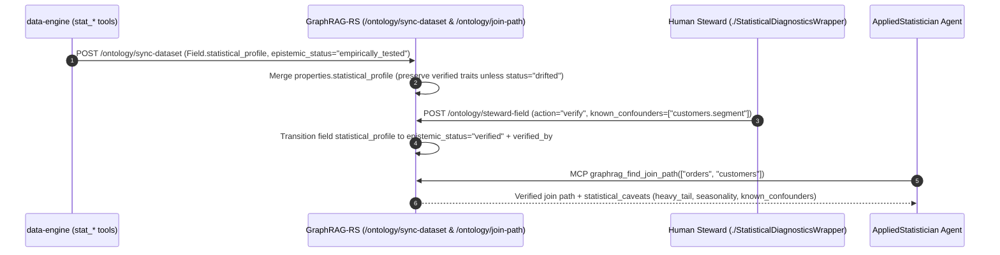

# Spec 24: Epistemic Statistical Traits, Known Confounders & Join-Path Statistical Caveats

- **Status**: `draft`
- **Derived From**: [autonomous-semantic-ontology-prd.md](../prds/autonomous-semantic-ontology-prd.md)
- **Dependencies**: [22-ontology-schema-and-dataset-sync-spec.md](./22-ontology-schema-and-dataset-sync-spec.md), [23-ontology-join-path-planner-spec.md](./23-ontology-join-path-planner-spec.md)

---

## 1. Objective
Extend **GraphRAG-RS**'s autonomous ontology sync and join-path planner so discovered statistical traits and known confounders from `data-engine` persist on `Dataset` and `Field` nodes inside `knowledge_objects.properties` (`JSONB`), follow the existing epistemic stewardship lifecycle (`empirically_tested` $\rightarrow$ `pending_review` $\rightarrow$ `verified` / `drifted`), and surface automatically inside `POST /ontology/join-path` (`graphrag_find_join_path`) responses.

---

## 2. Statistical Trait Sync & Join-Path Caveat Flow



---

## 3. Payload Contracts & Behavior

### 3.1 `StatisticalProfile` Schema (`properties.statistical_profile` on `knowledge_objects`)
No new DDL migration is required — `knowledge_objects.properties` (`JSONB`) and `epistemic_status`/`verified_by`/`confidence` already exist (Spec 22). Extend the `OntologySyncField` DTO in `POST /ontology/sync-dataset` and MCP `ontology_sync_dataset` with an optional `statistical_profile`:
```json
{
  "distribution_family": "log_normal_heavy_tailed",
  "is_heavy_tailed": true,
  "skewness": 4.82,
  "kurtosis": 31.4,
  "seasonality_period": null,
  "recommended_test_family": "non_parametric_or_log_transform",
  "known_confounders": ["customers.segment"],
  "last_diagnosed_run_id": "9f1c2e34-...",
  "epistemic_status": "empirically_tested",
  "confidence": 0.93,
  "verified_by": null
}
```
- **Epistemic Preservation Rule**:
  - When upserting a `Field` or `Dataset` node whose existing `properties.statistical_profile.epistemic_status == "verified"`, subsequent `sync_dataset_ontology` calls with `epistemic_status != "drifted"` MUST preserve the human-verified `recommended_test_family`, `known_confounders`, and `verified_by` (updating only observational metrics like `last_diagnosed_run_id` if non-conflicting).
  - If `epistemic_status == "drifted"` is explicitly signaled (e.g., severe distribution shift), transition `properties.statistical_profile.epistemic_status = "drifted"` and record `previous_verified_profile` for steward review.

### 3.2 Field Stewardship Endpoint (`POST /ontology/steward-field` & MCP `ontology_steward_field`)
Allows a human steward (from `de-fe-container`'s `./StatisticalDiagnosticsWrapper` or `./DataAssetFormWrapper`) to certify or edit a field's statistical traits:
```json
{
  "dataset_name": "sales_orders",
  "field_name": "order_total_usd",
  "action": "verify",
  "verified_by": "steward_alice",
  "recommended_test_family": "non_parametric_or_log_transform",
  "known_confounders": ["customers.segment"],
  "steward_notes": "Whale enterprise orders create extreme right skew; always use Mann-Whitney U or log-Welch."
}
```

### 3.3 Join-Path Response Extension (`POST /ontology/join-path` & MCP `graphrag_find_join_path`)
Extend `JoinPathResponse` with:
```json
{
  "statistical_caveats": [
    {
      "canonical_id": "sales_orders.order_total_usd",
      "distribution_family": "log_normal_heavy_tailed",
      "is_heavy_tailed": true,
      "seasonality_period": null,
      "recommended_test_family": "non_parametric_or_log_transform",
      "known_confounders": ["customers.segment"],
      "epistemic_status": "verified",
      "verified_by": "steward_alice"
    }
  ]
}
```
Aggregates `statistical_profile` metadata from all participating Layer 1 (`Dataset`) and Layer 0 (`Field`) nodes in the resolved subgraph.

---

## 4. Test Strategy (TDD)

### Unit & Database Integration Tests (`cargo test`)
1. `test_sync_dataset_persists_statistical_profile_in_field_properties`: Syncs a dataset containing `statistical_profile` (`is_heavy_tailed = true`, `known_confounders = ["customers.segment"]`) and verifies persistence in `knowledge_objects.properties`.
2. `test_steward_verify_field_protects_statistical_profile_from_unverified_overwrite`: Verifies `POST /ontology/steward-field` transitions `statistical_profile.epistemic_status` to `"verified"` and that a subsequent `empirically_tested` sync does not overwrite human-verified `recommended_test_family` or `known_confounders`.
3. `test_drifted_sync_transitions_verified_statistical_profile_to_drifted`: Verifies that an explicit `epistemic_status = "drifted"` sync marks the profile `"drifted"` while preserving `previous_verified_profile`.
4. `test_join_path_returns_statistical_caveats_for_participating_fields`: Calls `POST /ontology/join-path` across synced datasets and asserts `statistical_caveats` surfaces heavy-tail flags, seasonality periods, and `known_confounders`.

### Integration Tests (Robot Framework)
- End-to-end Robot test calling MCP `ontology_sync_dataset` $\rightarrow$ `ontology_steward_field` $\rightarrow$ `graphrag_find_join_path`, verifying `statistical_caveats` are returned with `epistemic_status == "verified"`.
