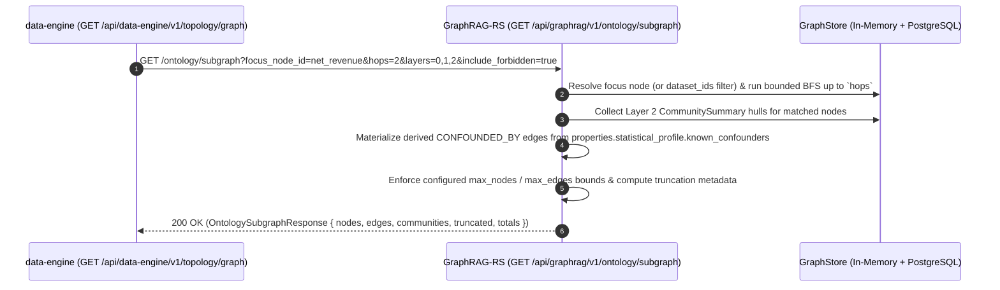

# Spec 25: Bounded Ontology Subgraph Export for Topology Visualization (`GET /ontology/subgraph` & MCP `graphrag_export_subgraph`)

- **Status**: `complete`
- **Derived From**: [autonomous-semantic-ontology-prd.md](../prds/autonomous-semantic-ontology-prd.md), [graph-rag-mcp-prd.md](../prds/graph-rag-mcp-prd.md)
- **Dependencies**: [22-ontology-schema-and-dataset-sync-spec.md](./22-ontology-schema-and-dataset-sync-spec.md), [23-ontology-join-path-planner-spec.md](./23-ontology-join-path-planner-spec.md), [24-epistemic-statistical-traits-and-confounders-spec.md](./24-epistemic-statistical-traits-and-confounders-spec.md)

---

## 1. Objective
Expose a single bounded subgraph export endpoint (`GET ${api_prefix}/ontology/subgraph` & `GET /ontology/subgraph`) and matching `rmcp` MCP tool (`graphrag_export_subgraph`) so [`data-engine`](https://github.com/PolecatWorks/data-engine)'s `./SemanticTopologyWrapper` and autonomous agents can retrieve Layer 2 Business Concepts, Business Metrics, Community Summaries, Layer 1 Datasets, Layer 0 Fields, `JOINABLE_WITH` / `FORBIDDEN_JOIN` tuples, and derived `CONFOUNDED_BY` relationships in one deterministic, bounded call without N+1 node/edge lookups.

---

## 2. Subgraph Export & Topology Fusion Flow



---

## 3. Configuration, Typed Errors & Payload Contracts

### 3.1 Modular Subgraph Configuration (`OntologySubgraphConfig`)
Added to GraphRAG's modular ontology configuration (`GRAPHRAG_BE__ONTOLOGY__SUBGRAPH__*`, zero hardcoded runtime defaults, fail-fast `.validate()`):
- `default_hops: u8` (default `2`; validated `1..=5`)
- `max_hops: u8` (default `5`; validated `>= default_hops && <= 8`)
- `default_max_nodes: usize` (default `250`; validated `10..=5000`)
- `default_max_edges: usize` (default `500`; validated `10..=20000`)

### 3.2 Typed Error Variants (`GraphRagError`)
- `GraphRagError::InvalidSubgraphQuery(String)` $\rightarrow$ `400 Bad Request` (e.g., `hops == 0`, `hops > max_hops`, invalid layer number)
- `GraphRagError::NodeNotFound(String)` $\rightarrow$ `404 Not Found` (when `focus_node_id` is provided and does not exist in `knowledge_objects`)

### 3.3 REST Query & MCP Request DTO (`OntologySubgraphRequest`)
```rust
#[derive(Debug, Clone, Deserialize, JsonSchema)]
pub struct OntologySubgraphRequest {
    pub focus_node_id: Option<String>,
    pub hops: Option<u8>,
    pub layers: Option<Vec<u8>>,          // e.g. [0, 1, 2]; comma-separated in REST query
    pub dataset_ids: Option<Vec<String>>, // canonical dataset IDs; comma-separated in REST query
    pub epistemic_status: Option<String>, // optional status filter
    pub include_forbidden: Option<bool>,  // default true
    pub max_nodes: Option<usize>,         // capped by OntologySubgraphConfig
    pub max_edges: Option<usize>,         // capped by OntologySubgraphConfig
}
```

### 3.4 Response Payload (`OntologySubgraphResponse`)
```json
{
  "nodes": [
    {
      "id": "net_revenue",
      "label": "BusinessMetric",
      "layer": 2,
      "description": "gross_usd - discount_usd for non-cancelled orders",
      "epistemic_status": "verified",
      "confidence": 1.0,
      "verified_by": "steward_alice",
      "properties": { "formula": "gross_usd - discount_usd" }
    },
    {
      "id": "sales_orders.amount_usd",
      "label": "Field",
      "layer": 0,
      "description": "Order total in USD",
      "epistemic_status": "drifted",
      "confidence": 0.91,
      "verified_by": null,
      "properties": {
        "statistical_profile": {
          "is_heavy_tailed": true,
          "known_confounders": ["crm_customers.segment"]
        }
      }
    }
  ],
  "edges": [
    {
      "source_id": "net_revenue",
      "predicate": "COMPUTED_FROM",
      "target_id": "sales_orders.amount_usd",
      "epistemic_status": "verified",
      "confidence": 1.0,
      "derived": false,
      "properties": {}
    },
    {
      "source_id": "sales_orders.amount_usd",
      "predicate": "CONFOUNDED_BY",
      "target_id": "crm_customers.segment",
      "epistemic_status": "empirically_tested",
      "confidence": 0.91,
      "derived": true,
      "properties": { "source": "statistical_profile.known_confounders" }
    }
  ],
  "communities": [
    {
      "id": "comm_revenue_billing",
      "label": "Revenue & Billing",
      "layer": 2,
      "member_node_ids": ["net_revenue", "sales_orders", "crm_customers"]
    }
  ],
  "truncated": false,
  "total_matching_nodes": 2,
  "total_matching_edges": 2
}
```

### 3.5 Traversal & Determinism Rules
1. **Focus Ego-Network**: When `focus_node_id` is supplied, normalize via `normalize_entity_id`, verify existence (`404` if missing), and run undirected-neighborhood BFS up to `hops` over `graph_tuples` (excluding `FORBIDDEN_JOIN` only when `include_forbidden == false`).
2. **Dataset Scoping**: When `dataset_ids` is supplied without `focus_node_id`, seed BFS from the requested Layer 1 `Dataset` nodes and traverse down (`HAS_FIELD`, `JOINABLE_WITH`, `FORBIDDEN_JOIN`) and up (`DEFINED_BY`, `GOVERNED_BY`, `COMPUTED_FROM`, `SUMMARIZES`) up to `hops`.
3. **Derived Confounder Edges**: For any included node carrying `properties.statistical_profile.known_confounders`, emit a synthetic edge `{ source_id: node.id, predicate: "CONFOUNDED_BY", target_id: confounder_id, derived: true }` whenever `target_id` is present in the resolved node set (or include `target_id` if within node budget).
4. **Deterministic Ordering & Truncation**: Sort nodes by `(layer DESC, epistemic_priority, id ASC)` and edges by `(source_id, predicate, target_id)` before applying `max_nodes`/`max_edges`, guaranteeing deterministic output across runs and filtering out dangling edges whose endpoints were truncated.

---

## 4. Test Strategy (TDD)

### Unit & Database Integration Tests (`cargo test`)
1. `test_ontology_subgraph_config_validation_rejects_invalid_bounds`: Verifies `OntologySubgraphConfig::validate()` rejects `default_hops == 0`, `max_hops < default_hops`, and zero node/edge caps.
2. `test_export_subgraph_ego_network_respects_hops_and_layers`: Seeds Layer 2 `BusinessMetric` -> Layer 1 `Dataset` -> Layer 0 `Field` + `JOINABLE_WITH` + `FORBIDDEN_JOIN`; asserts `hops=1` vs. `hops=2` and `layers=[1,2]` filtering.
3. `test_export_subgraph_includes_forbidden_join_and_derived_confounders`: Asserts `FORBIDDEN_JOIN` appears when `include_forbidden=true`, disappears when `include_forbidden=false`, and `known_confounders` materializes a `derived: true` `CONFOUNDED_BY` edge.
4. `test_export_subgraph_enforces_max_nodes_truncation_without_dangling_edges`: Caps `max_nodes=3` on a larger graph and asserts `truncated == true`, `nodes.len() == 3`, `total_matching_nodes > 3`, and every returned edge references only returned nodes.
5. `test_export_subgraph_returns_404_for_unknown_focus_node`: Asserts `GET /ontology/subgraph?focus_node_id=does_not_exist` returns `404 Not Found`.

### REST & MCP Integration Tests (Robot Framework)
- Verify `GET /api/graphrag/v1/ontology/subgraph` and MCP `tools/call` for `graphrag_export_subgraph` return valid `OntologySubgraphResponse` payloads containing Layer 2 Concepts/Metrics, Layer 1 Datasets, Layer 0 Fields, `communities`, and `CONFOUNDED_BY` edges.
