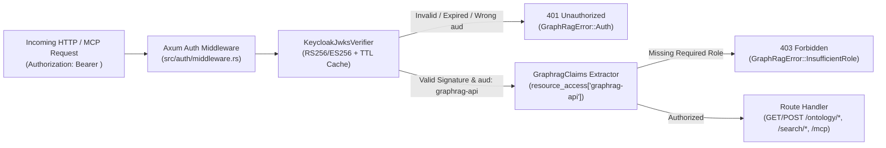

# Spec 26: Keycloak JWKS Authentication, `graphrag-api` Claims Gatekeeper & `graphrag-sa` Service Auth (`src/auth/`)

- **Status**: `draft`
- **Derived From**: [keycloak-claims-and-service-auth-prd.md](../prds/keycloak-claims-and-service-auth-prd.md)
- **Dependencies**: [04-axum-service-spec.md](./04-axum-service-spec.md), [11-modular-config-validation-spec.md](./11-modular-config-validation-spec.md), [12-typed-error-handling-spec.md](./12-typed-error-handling-spec.md), [17-graph-rag-mcp-service-spec.md](./17-graph-rag-mcp-service-spec.md), [20-configurable-api-prefix-and-virtualservice-spec.md](./20-configurable-api-prefix-and-virtualservice-spec.md)

---

## 1. Objective

Implement OIDC Bearer token verification via Keycloak JWKS and domain-specific claims enforcement for all GraphRAG REST and MCP endpoints (`/api/graphrag/v1/...` and `/mcp`), with **zero dev/fake auth bypasses** in any environment.
1. **Resource Server Protection (`graphrag-api`)**: Validates OIDC Bearer tokens against cluster Keycloak JWKS.
2. **Domain-Specific Client Roles**: Enforces `graph:read`, `graph:write`, and `graph:admin` from `resource_access["graphrag-api"].roles`.
3. **Ecosystem Realm Groups Integration**: Compatible with roles granted via `DataAgentAdmins` and `DataAgentUsers` realm groups.
4. **Machine-to-Machine Integration (`graphrag-sa`)**: M2M service account authentication for downstream data connectors.
5. **Fail-Closed Security**: Rejection with `401 Unauthorized` or `403 Forbidden` on invalid, expired, or insufficient tokens.

---

## 2. Request Flow & Middleware Architecture



---

## 3. Configuration & Error Handling Contract

### 3.1 Modular Auth Configuration (`AuthConfig`)
Added to GraphRAG's modular configuration (`GRAPHRAG_BE__AUTH__*`, zero hardcoded runtime defaults, fail-fast `.validate()`):
```rust
#[derive(Debug, Clone, Deserialize, Serialize)]
pub struct AuthConfig {
    pub issuer_url: String,           // e.g. "http://keycloak-keycloakx-http.auth.svc.cluster.local/auth/realms/sw-dev"
    pub jwks_url: String,             // e.g. "http://keycloak-keycloakx-http.auth.svc.cluster.local/auth/realms/sw-dev/protocol/openid-connect/certs"
    pub expected_audience: String,    // default in config.yaml: "graphrag-api"
    pub jwks_cache_ttl_seconds: u64,  // default: 300 (must be > 0)
}
```
Validation rules:
- `issuer_url` must be a valid HTTP/HTTPS URL.
- `jwks_url` must be a valid HTTP/HTTPS URL.
- `expected_audience` must not be empty.
- `jwks_cache_ttl_seconds` must be `> 0`.
- Zero bypass or disable flags are permitted.

### 3.2 Typed Errors (`GraphRagError`)
- `GraphRagError::MissingBearerToken` $\rightarrow$ `401 Unauthorized`
- `GraphRagError::InvalidToken(String)` $\rightarrow$ `401 Unauthorized`
- `GraphRagError::JwksFetchFailed(String)` $\rightarrow$ `503 Service Unavailable`
- `GraphRagError::InsufficientRole { required: String }` $\rightarrow$ `403 Forbidden`

---

## 4. Claims Structure & Role Mapping

### 4.1 Token Claims Representation (`GraphragClaims`)
```rust
#[derive(Debug, Clone, Deserialize, Serialize)]
pub struct GraphragClaims {
    pub sub: String,
    pub iss: String,
    pub aud: Vec<String>,
    pub preferred_username: Option<String>,
    pub email: Option<String>,
    pub resource_access: HashMap<String, ClientRoles>,
    pub graphrag: Option<GraphragCustomClaims>,
}

#[derive(Debug, Clone, Deserialize, Serialize)]
pub struct ClientRoles {
    pub roles: Vec<String>,
}

#[derive(Debug, Clone, Deserialize, Serialize)]
pub struct GraphragCustomClaims {
    pub allowed_domains: Vec<String>,
    pub max_traversal_depth: Option<u8>,
    pub vector_search_limit: Option<usize>,
}
```

### 4.2 Endpoint Role Gates
- `graph:read`:
  - `GET /ontology/subgraph`
  - `POST /ontology/join-path`
  - `GET /api/v1/search/*`
  - MCP `graphrag_export_subgraph`, `graphrag_join_path`, `graphrag_search`
- `graph:write`:
  - `POST /ontology/sync-dataset`
  - `POST /ontology/steward-field`
  - `POST /api/v1/documents/*`
- `graph:admin`:
  - `DELETE /ontology/*`
  - Schema wipe, re-index, and administrative partition management.

---

## 5. Test Strategy

### 5.1 Unit Tests (`src/auth/`)
- Test `AuthConfig::validate()` fail-fast validation on malformed URLs or empty fields.
- Test JWKS key parsing (RS256/ES256) and mock token verification.
- Test `GraphragClaims` extraction, verifying roles from `resource_access["graphrag-api"]`.
- Test role enforcement rejection (`InsufficientRole`) when a required role is missing.

### 5.2 Integration Tests (`integration-tests/`)
- Verify that requests without `Authorization` header return `401 Unauthorized`.
- Verify requests with tokens belonging to `DataAgentAdmins` (having `graph:read`, `graph:write`, `graph:admin`) succeed on all endpoints.
- Verify requests with tokens belonging to `DataAgentUsers` (having `graph:read`, `graph:write`) succeed on read/write endpoints and fail with `403 Forbidden` on admin endpoints.
